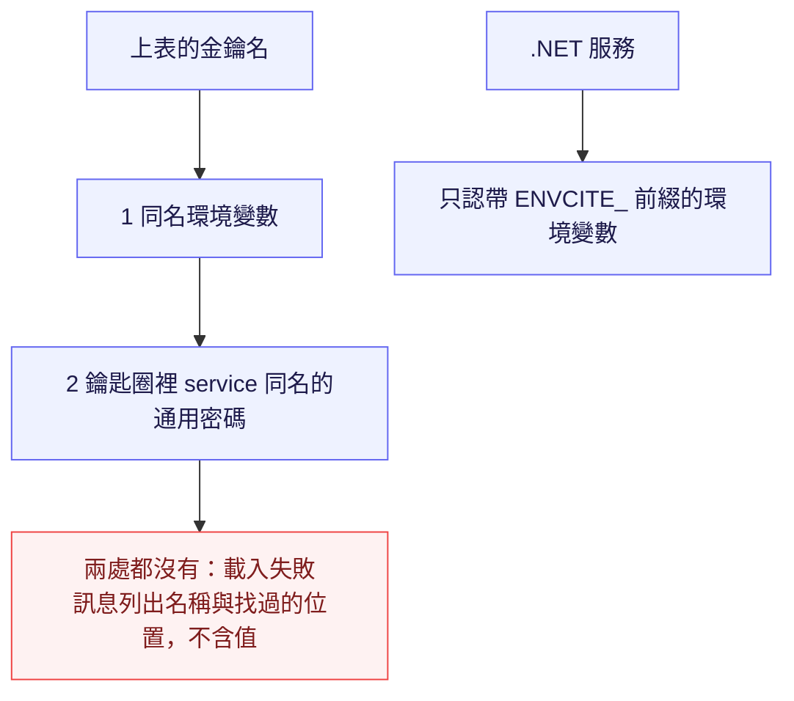

<!--
type: reference
applies-to: all
owns: [config-naming, secret-sources]
-->

# 設定與金鑰

先照[命名](#命名)決定環境變數的名字，再照[機密的來源](#機密的來源)決定這個名字的值放哪裡。回[倉庫總覽](README.md)；各服務的具體鍵見其 README。

## 概念

| 層 | 節 | 這裡有 |
|----|----|--------|
| 名字 | [命名](#命名) | `ENVCITE_` 與不走此前綴的標準名 |
| 值 | [機密的來源](#機密的來源) | 環境變數，然後作業系統鑰匙圈 |

## 命名

| 適用 | 形式 | 例子 | 前提 |
|------|------|------|------|
| 預設 | `ENVCITE_` 開頭 | — | — |
| 第三方工具自己的標準名 | `OTEL_*`、libpq 的 `PG*`、`ASPNETCORE_*`、`DOTNET_*`、`ANTHROPIC_API_KEY` | — | 改了就不再被該工具讀到 |
| Python | `ENVCITE_<服務>_<名稱>`，全大寫、單底線 | `ENVCITE_ONTOLOGY_DSN` | `env_prefix` 是 `ENVCITE_<服務>_`，欄位名是 `<名稱>` 小寫 |
| .NET | `ENVCITE_` ＋ 設定路徑，`:` 寫成 `__` | `ENVCITE_Platform__AdminKeySha256` 對應 `Platform:AdminKeySha256` | 路徑沿用 `appsettings.json` 的區段與大小寫；.NET 設定不分大小寫，文件與部署清單照 `appsettings.json` 寫 |
| 共用函式庫 | `ENVCITE_<套件>_<名稱>` | `ENVCITE_JOBKIT_OPEN_SECONDS` | — |
| 工具腳本 | 沿用所屬服務的前綴 | `ENVCITE_ONTOLOGY_DEV_DSN`、`ENVCITE_ONTOLOGY_TEST_DSN` | — |
| 機密 | 以 `_API_KEY`、`_PASSWORD` 或 `_SECRET` 結尾 | — | 非機密不用這些結尾。一看名稱就知道不能進設定檔、日誌與測試輸出 |

## 機密的來源

名字定了之後才找值。設定檔不放機密值，也不寫金鑰的名稱。

`models.toml` 的端點表只有 `base_url`。金鑰名由端點名推導：**`ENVCITE_` ＋ 端點名大寫 ＋ `_API_KEY`**。

```toml
[endpoint.llm]                       # 金鑰名：ENVCITE_LLM_API_KEY
base_url = "https://…/v1"
```

| 端點名 | 金鑰名 |
|--------|--------|
| 小寫字母開頭，其後小寫字母、數字與底線（`[a-z][a-z0-9_]*`） | `ENVCITE_` ＋ 端點名大寫 ＋ `_API_KEY` |
| 含連字號或大寫 | 載入失敗（轉不成合法且不重名的環境變數） |
| `provider = "anthropic"` | 不經端點，金鑰是 `ANTHROPIC_API_KEY` |

每個端點都要有金鑰，缺則載入失敗。



取第一個非空者。

| 順序 | 哪裡 | 誰在用 |
|------|------|--------|
| 1 | 同名環境變數 | 容器、CI、Linux 伺服器。容器沒有鑰匙圈，缺了就直接失敗 |
| 2 | 作業系統鑰匙圈 | 開發者機器。macOS：`security find-generic-password -s <名稱> -w`。Linux：`secret-tool lookup service <名稱>`（libsecret）。Windows 與沒有鑰匙圈的環境只有第 1 項 |

同一個 `models.toml` 因此各環境寫法相同。金鑰經子行程的標準輸出回到本行程，不進命令列、不進日誌。

存入鑰匙圈（值由終端機提示輸入，不經命令列）：

```bash
security add-generic-password -s ENVCITE_LLM_API_KEY -a "$USER" -w      # macOS
secret-tool store --label=ENVCITE_LLM_API_KEY service ENVCITE_LLM_API_KEY   # Linux
```

.NET 服務不讀鑰匙圈，所以圖的右側在環境變數停下。來源是 `EnvCite.ServiceDefaults` 的 `AddServiceEnvironment`（取代預設不帶前綴的來源）。`OTEL_*` 以原名保留給 OpenTelemetry。
