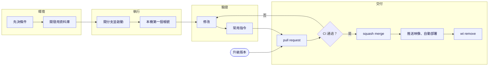

<!--
type: tutorial
applies-to: local
owns: [dev-seed-accounts, shared-dev-db]
-->

# 參與開發

從本機環境到 pull request 合併的作業流程。[概念](#概念)給出分層與順序，[索引](#索引)列出本頁引用的全部外部文件與真值檔案。回[倉庫總覽](README.md)。

## 概念



| 層 | 節 | 完成條件 |
|----|----|----------|
| 環境 | [先決條件](#先決條件) | 所列工具已安裝，版本與各自的真值一致 |
| 環境 | [開發用資料庫](#開發用資料庫) | `envcite`、`platform` 兩個資料庫可連線，所需擴充已啟用 |
| 執行 | [開分支並啟動](#開分支並啟動) | `wt list` 顯示本分支 platform 的 URL |
| 執行 | [本機第一個帳號](#本機第一個帳號) | 以終端機印出的一次性密碼登入成功 |
| 執行 | [本機建立與救援營運者](#本機建立與救援營運者) | 按需：建立第二個營運者，或重設密碼與驗證器 |
| 驗證 | [常用指令](#常用指令) | 該服務要求的檢查在服務目錄通過 |
| 交付 | [從開發到上線](#從開發到上線) | pull request 已 squash merge，worktree 已移除 |
| 維護 | [升級版本](#升級版本) | 同一版本在表上的每一處於同一次提交更新 |

## 索引

各文件擁有自己領域的定義；本頁只做指引，不重述其內容。

| 層 | 文件 | 擁有 |
|----|------|------|
| 倉庫 | [README「目錄」](README.md#目錄) | 目錄與各服務入口 |
| 倉庫 | [`AGENTS.md`](AGENTS.md) | 代理作業規範、指令、契約與安全規則 |
| 契約 | [`proto/README.md`](proto/README.md#概念) | 服務組合、呼叫端接法、契約版本規則 |
| 契約 | [platform README「語料範圍」](services/platform/README.md#語料範圍) | 語料範圍與拒答解讀 |
| 服務 | [platform README](services/platform/README.md#概念) · [AGENTS](services/platform/AGENTS.md) | 端點、設定鍵、營運者帳號；服務指令 |
| 服務 | [consult README](services/consult/README.md#概念) · [AGENTS](services/consult/AGENTS.md) | 接地契約、代號、可答性規則；服務指令 |
| 服務 | [ontology README](services/ontology/README.md#概念) · [AGENTS](services/ontology/AGENTS.md) | 法規匯入、檢索與推論端點、環境變數；服務指令 |
| 共用 | [`libs/dotnet/README.md`](libs/dotnet/README.md) | .NET 共用主機設定 |
| 共用 | [`libs/python/AGENTS.md`](libs/python/AGENTS.md) | Python 套件清單與規則 |
| 設定 | [`CONFIGURATION.md`](CONFIGURATION.md#概念) | 環境變數命名與機密來源 |
| 帳號 | [platform README「營運者帳號」](services/platform/README.md#營運者帳號) | 帳號欄位、端點、首次登入 |
| 部署 | 容器層 `core-env-saas/AGENTS.md`「任務入口」 | 部署庫文件的入口，如 staging 建立營運者 |

下列是本頁指向的真值檔案，版本與規則以它們為準：

| 真值 | 擁有 |
|------|------|
| [`.config/wt.toml`](.config/wt.toml) | worktree 的依賴安裝、由分支推導的連接埠、`wt` 別名與連線預設值 |
| [`ci/detect-changes.sh`](ci/detect-changes.sh) | CI 依變更路徑分流 |
| [`.github/workflows/ci.yml`](.github/workflows/ci.yml) | CI 流程與工具版本變數；本頁簡稱 `ci.yml` |
| [`renovate.json`](renovate.json) | 依賴升級的 pull request 規則 |
| [`.githooks/`](.githooks) | 阻擋在 `main` 上提交與編輯 |
| [`services/ontology/migrations/`](services/ontology/migrations) | ontology 資料庫綱要 |

## 先決條件

| 工具 | 用途 | 版本真值 |
|------|------|----------|
| Git | 分支與提交 | — |
| [Worktrunk](https://worktrunk.dev)（`wt`） | 每條分支一棵 worktree，並安裝依賴 | `.config/wt.toml` |
| Docker | 測試（Testcontainers）、映像建置、開發用資料庫 | — |
| PostgreSQL（含 pgvector） | 開發用的 `envcite`、`platform` 兩個資料庫 | `ci.yml` 的 `POSTGRES_MAJOR`，與正式環境同主版本 |
| .NET SDK | [platform](services/platform/README.md)、[consult](services/consult/README.md)、[`libs/dotnet/`](libs/dotnet/README.md) | [`global.json`](global.json) |
| [uv](https://docs.astral.sh/uv/) | [ontology](services/ontology/README.md)、[`libs/python/`](libs/python/AGENTS.md) | `ci.yml` 的 `UV_VERSION`；Python 版本見 `.python-version`，由 uv 自動安裝 |
| Node.js | 以 `npx` 執行 buf | `ci.yml` 的 `BUF_VERSION` |

## 開發用資料庫

| 資料庫 | 使用者 | 連線設定 |
|--------|--------|----------|
| `envcite` | [ontology](services/ontology/README.md) | `ENVCITE_ONTOLOGY_DSN` |
| `platform` | [platform](services/platform/README.md) | `ENVCITE_ConnectionStrings__Platform` |

| 前提 | 說明 |
|------|------|
| 擴充 | 連線帳號須能在 `envcite` 建立 `btree_gist` 與 `vector`（pgvector） |
| 預設值 | 未設定環境變數時，`wt` 別名（`.config/wt.toml`）與 platform 的 `appsettings.Development.json` 提供本機預設連線 |
| 共用 | 各分支共用這兩個資料庫。同一時間只執行一條分支的服務，否則 migration 互相覆寫 |
| 測試 | 不使用這兩個資料庫；Testcontainers 每次自行建立臨時資料庫 |
| migration 檔變更 | 清空 ontology 的資料庫綱要，重新執行 migration 並重新匯入 |

以 Docker 建立臨時資料庫。帳號、密碼取 `wt` 別名的預設連線；映像標籤的主版本見[先決條件](#先決條件)：

```bash
docker run -d --name envcite-pg -p 127.0.0.1:5432:5432 \
  -e POSTGRES_USER=<帳號> -e POSTGRES_PASSWORD=<密碼> -e POSTGRES_DB=envcite \
  pgvector/pgvector:pg<主版本>
docker exec envcite-pg createdb -U <帳號> platform
```

## 開分支並啟動

兩個資料庫須已就緒（見[開發用資料庫](#開發用資料庫)）。

| 順序 | 完成條件 |
|------|----------|
| 1 | worktree 已建立，依賴已安裝 |
| 2 | ontology、consult、platform 皆已啟動。ontology 須先啟動：它先執行 migration 再監聽連接埠 |
| 3 | 法規已匯入，ontology 已重啟 |
| 4 | `wt list` 的 URL 是本分支 platform 的位址，下一節以它登入 |

1. `wt switch --create <type>/<簡述>`。`type` 同 Conventional Commits，如 `feat`、`fix`、`docs`、`refactor`、`chore`、`ci`、`test`。
2. 各開一個終端機：

   ```bash
   wt ontology
   wt consult
   wt platform
   ```

3. 首次匯入法規（ontology 的資料庫預設為空）。入口與環境變數見 [`services/ontology/README.md`](services/ontology/README.md)。詞典只在啟動時讀取，匯入後須重啟 `wt ontology`：

   ```bash
   cd services/ontology
   cp .env.example .env     # 填入連線與快照目錄
   uv run --env-file .env envcite-sync moj
   ```

## 本機第一個帳號

僅適用本機 Development 環境；其他環境沒有種子（seed）帳號，見[索引](#索引)的「部署」列。

| 條件 | 建立內容 |
|------|----------|
| Development，且 `Platform:SeedDevelopmentData` 啟用 | 空資料庫首次執行 `wt platform` 時，建立種子租戶與擁有者 |
| 資料庫內沒有任何營運者 | 同時建立一個營運者 |
| 之後再啟動 | 不再印出帳號 |

帳號與一次性密碼只在該終端機印出一次，不寫入日誌，程式碼內沒有預設密碼。

| 角色 | 登入位址 | 首次登入 |
|------|----------|----------|
| 租戶擁有者 | `http://localhost:<port>/portal/<租戶>/login` | 變更密碼 |
| 營運者 | `http://localhost:<port>/ui/login` | 依畫面變更密碼並綁定 TOTP，本機亦無例外 |

`<port>` 取自 `wt list` 的 URL。忘記密碼時，清空 `platform` 資料庫並從[開發用資料庫](#開發用資料庫)重建，或以[命令列](#本機建立與救援營運者)重設。欄位與指令見[索引](#索引)的「帳號」列。

### 本機建立與救援營運者

建立第二個營運者，或重設密碼與驗證器時才需要；後台 `/ui/operators` 也能新增與重設。指令在 `services/platform` 目錄執行，連線沿用 `appsettings.Development.json` 的本機預設：

```bash
cd services/platform
ASPNETCORE_ENVIRONMENT=Development dotnet run --project src/EnvCite.Platform.Api --no-launch-profile -- operator create <email> [顯示名稱]
ASPNETCORE_ENVIRONMENT=Development dotnet run --project src/EnvCite.Platform.Api --no-launch-profile -- operator resend-invite <email>
ASPNETCORE_ENVIRONMENT=Development dotnet run --project src/EnvCite.Platform.Api --no-launch-profile -- operator reset-password <email>
ASPNETCORE_ENVIRONMENT=Development dotnet run --project src/EnvCite.Platform.Api --no-launch-profile -- operator reset-two-factor <email>
```

一次性密碼只印在該終端機。指令的契約與結束碼見 [platform README「營運者帳號」](services/platform/README.md#營運者帳號)。

### 本機收信與寄信測試

啟用寄信（`Platform:Mail`）後，新增營運者或成員改為寄邀請信，對方開啟連結自己設定密碼；沒啟用時仍是上面的一次性密碼。流程、鍵與排查見 [platform README「邀請與信箱驗證」](services/platform/README.md#邀請與信箱驗證)與[「寄信」](services/platform/README.md#寄信platformmail)。部署環境（staging）的設定與驗證步驟見[索引](#索引)的「部署」列。

本機用 [Mailpit](https://github.com/axllent/mailpit) 接信：它是收信用的 SMTP 伺服器，信只留在它的網頁介面，不會寄到任何真實信箱。

```bash
docker run -d --rm --name envcite-mailpit -p 1025:1025 -p 8025:8025 axllent/mailpit
```

在 `services/platform` 以環境變數啟動 platform。`BaseUrl` 要與服務實際監聽的位址一致，信裡的連結才打得開：

```bash
cd services/platform
ASPNETCORE_ENVIRONMENT=Development \
ENVCITE_Platform__Mail__Enabled=true \
ENVCITE_Platform__Mail__Host=localhost \
ENVCITE_Platform__Mail__Port=1025 \
ENVCITE_Platform__Mail__From=envcite@example.test \
ENVCITE_Platform__Mail__BaseUrl=http://localhost:5080 \
dotnet run --project src/EnvCite.Platform.Api --no-launch-profile -- --urls http://localhost:5080
```

1. 以種子營運者登入 `/ui/login`，到「營運者」新增一位（email 用 `.test` 網域），或到租戶頁新增成員。
2. 開 <http://localhost:8025> 看邀請信，開啟信裡的連結，設定密碼。連結只能用一次；重開應顯示「連結無效或已過期」。
3. 用新密碼登入。營運者接著綁定驗證器。

只想驗證寄信設定，不建帳號：同樣的環境變數下執行 `mail test`，Mailpit 會收到一封沒有連結、沒有密碼的測試信。

```bash
ASPNETCORE_ENVIRONMENT=Development ENVCITE_Platform__Mail__Enabled=true ENVCITE_Platform__Mail__Host=localhost \
ENVCITE_Platform__Mail__Port=1025 ENVCITE_Platform__Mail__From=envcite@example.test ENVCITE_Platform__Mail__BaseUrl=http://localhost:5080 \
dotnet run --project src/EnvCite.Platform.Api --no-launch-profile -- mail test probe@example.test
```

**對真實中繼測試**：把 `Host`、`Port`、`From` 換成中繼的值，`BaseUrl` 換成服務的 https 位址，收件者換成自己的信箱，執行同一個 `mail test`。不加密、免驗證的中繼只信任特定來源位址，所以：

- 從自己的電腦測通，只證明中繼可達；**服務實際執行的環境**（pod 的出口位址）是否被信任，要在那個環境裡執行 `mail test` 才知道。
- 結束碼 `0` 只代表中繼接受了信；到收件匣確認有收到。失敗時依 README 的排查表，細節在服務日誌的 `Mail delivery failed` 那一行。
- 測試信不含連結與密碼，可以放心寄到真實信箱；邀請信則會讓收件者得到一把單次的鑰匙，測試時用自己的信箱。

## 常用指令

服務已在上一節啟動。檢查在該服務目錄執行：

| 動作 | [platform](services/platform/AGENTS.md)、[consult](services/consult/AGENTS.md) | [ontology](services/ontology/AGENTS.md) |
|------|------|------|
| 測試 | `dotnet test` | `uv run python -m pytest` |
| Lint | `dotnet format --verify-no-changes` | `uv run ruff check .` |
| 格式化 | `dotnet format` | `uv run ruff format .` |
| 型別檢查 | `dotnet build`（警告視為錯誤） | `uv run python -m mypy src tests` |
| 修改 proto 後重新產生 | 建置時自動產生 | `libs/python/envcite-proto/scripts/generate.sh` |

- Python 服務與 [`libs/python/`](libs/python/AGENTS.md) 同屬一個 uv workspace，在倉庫根執行 `uv sync --all-packages`（`wt` 建立 worktree 時已執行）。
- 契約相關指令從倉庫根執行；「修改 proto 的 pull request 須同時更新兩側產生碼」見 [`AGENTS.md`](AGENTS.md) 的 Commands 與 Contract。
- 各服務的完整指令與設定鍵見[索引](#索引)的「服務」列，環境變數命名見 [`CONFIGURATION.md`](CONFIGURATION.md#概念)。

檢查通過後進入下一節。

## 從開發到上線

分支已於[開分支並啟動](#開分支並啟動)建立。本節從提交到清理。

### 流程

| 順序 | 動作 | 要點 |
|------|------|------|
| 1 | Commit | [Conventional Commits](https://www.conventionalcommits.org)：`type(scope): 說明`；破壞性變更加 `!`，如 `feat(consult)!: …` |
| 2 | 對 `main` 開 pull request | `main` 受保護，不直接推送。CI 全數通過才能合併，以 squash merge 合併，合併後刪除來源分支 |
| 3 | 部署 | 合併後 CI 為受影響的服務推送映像（標籤為 `:<commit-sha>`），其後自動部署。流程與回退見部署庫，入口見[索引](#索引)的「部署」列 |
| 4 | 清理 | `wt remove <分支>` |

### 阻擋在 `main` 上改動

| 對象 | 機制 |
|------|------|
| commit | `.githooks/pre-commit`。`wt` 建立 worktree 時啟用；既有 clone 執行 `git config core.hooksPath .githooks` |
| 代理編輯 | `.githooks/block-main.sh`，依被編輯檔所在的 worktree 判斷分支，不看 hook 的工作目錄。測試見 `ci/test-block-main.sh` |

### CI 分流

CI 依變更路徑決定執行哪些 job，路由以 [`ci/detect-changes.sh`](ci/detect-changes.sh) 為準。

| 變更 | 影響範圍 |
|------|----------|
| 服務目錄（[platform](services/platform/README.md)、[consult](services/consult/README.md)、[ontology](services/ontology/README.md)） | 該服務的檢查與映像 |
| [`libs/dotnet/`](libs/dotnet/README.md)、倉庫根 `global.json`、`Directory.*.props`、`.editorconfig` | 所有 .NET 服務與其映像 |
| [`libs/python/`](libs/python/AGENTS.md) | 使用該套件的 Python 服務，與套件自身的檢查（`envcite-proto` 含產生碼是否與 `proto/` 一致） |
| 倉庫根 `pyproject.toml`、`uv.lock` | 所有 Python 服務與其映像 |
| [`proto/`](proto/README.md) | `buf lint`、`buf breaking`，與所有消費契約的服務 |

- 恆有一個 `gate` job，讓只改文件的 pull request 也有可合併的檢查。
- 非 `main` 分支的映像 job 只驗證可建置，不推送。

## 升級版本

上一節是日常流程的終點。升級依賴時才進入本節。

| 版本 | 變更位置 | 同一次提交還要 |
|------|----------|----------------|
| Python 套件 | 倉庫根 `uv lock --upgrade`（或 `--upgrade-package <pkg>`） | 升級 `grpcio-tools`、`mypy-protobuf`、`protobuf` 時，重新產生 `libs/python/envcite-proto` |
| .NET 套件 | 倉庫根 `Directory.Packages.props` | — |
| .NET SDK 與映像 | `services/{platform,consult}/Dockerfile`、`ci.yml` 的 `DOTNET_VERSION` | `global.json` 的 `sdk.version` 只是下限，Renovate 不動它。SDK 的 patch 版本決定隱含套件 `Microsoft.AspNetCore.App.Internal.Assets` 的版本：以新 SDK 執行 `dotnet restore --force-evaluate` 並更新 `packages.lock.json`，否則 CI 的 `--locked-mode` 失敗。本機 SDK 與 `DOTNET_VERSION` 同版，restore 才不會改動鎖檔 |
| Python | `.python-version`、`ci.yml` 的 `PYTHON_VERSION`、`services/ontology/Dockerfile` 的 `ARG PYTHON_VERSION` | — |
| uv | `ci.yml` 的 `UV_VERSION`、`services/ontology/Dockerfile` 的 `ARG UV_VERSION`、各 `pyproject.toml` 的 `uv_build` 範圍 | — |
| PostgreSQL | `ci.yml` 的 `POSTGRES_MAJOR`、`services/ontology/tests/conftest.py`、`services/ontology/tools/holdout.py`、`services/platform/tests/…/PlatformFactory.cs` | 主版本與正式環境相同。ontology 需要 pgvector，映像用 `pgvector/pgvector:pg<主版本>` |
| buf | `ci.yml` 的 `BUF_VERSION` | — |
| oasdiff | `ci.yml` 的 `OASDIFF_VERSION` | — |
| Docker（映像建置） | `ci.yml` 的 `DOCKER_VERSION` | — |
| hadolint | `ci.yml` 的 `HADOLINT_VERSION` | — |
| 後台字型（Inter、Noto Sans TC） | `services/platform/scripts/vendor-fonts.sh` 的 `INTER_VERSION`、`NOTO_VERSION` | 在 `services/platform` 執行該腳本，與重新產生的 `wwwroot/fonts/` 一併提交。Renovate 不追蹤 |

| 更新來源 | 規則 |
|----------|------|
| Renovate（[`renovate.json`](renovate.json)） | 依賴集中於單一設定檔，由它提 pull request |
| `ci.yml` 的 `# renovate:` 註記 | Renovate 辨識版本變數的依據。新增版本變數時一併加上 |
| Dockerfile 的 `ARG`、GitHub Actions 的 `uses:` | Renovate 內建解析，不需註記 |
| 執行處 | 由外部排程集中執行。本倉庫不存放令牌，也不執行該 job |
| 同一工具出現在多處 | 已設為同一個 pull request |
| 合併 | 不自動合併。合併進 `main` 會建置映像並自動部署，須先審閱 pull request |
