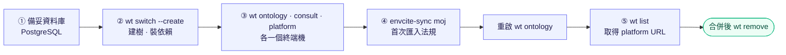

<!--
type: tutorial
applies-to: local
owns: [dev-seed-accounts, shared-dev-db]
-->

# 參與開發

本機環境、分支與上線流程。回[倉庫總覽](README.md)；agent 規範見 [`AGENTS.md`](AGENTS.md)。

## 先決條件

| 工具 | 版本以何處為準 | 用途 |
|------|----------------|------|
| Git | — | |
| [Worktrunk](https://worktrunk.dev)（`wt`） | — | 分支與本機環境（設定在 `.config/wt.toml`） |
| Docker | — | 測試（Testcontainers）、映像建置；可用來起開發用資料庫 |
| PostgreSQL | `.github/workflows/ci.yml` 的 `POSTGRES_MAJOR`（與正式區同主版本） | 開發用資料庫 |
| .NET SDK | [`global.json`](global.json) | [platform](services/platform/README.md)、[consult](services/consult/README.md)、[`libs/dotnet/`](libs/dotnet/README.md) |
| [uv](https://docs.astral.sh/uv/) | `.github/workflows/ci.yml` 的 `UV_VERSION` | Python workspace（[ontology](services/ontology/README.md)、[`libs/python/`](libs/python/AGENTS.md)）；Python 版本見 `.python-version`，由 uv 自動安裝 |
| Node.js | — | 以 `npx` 執行 buf |

## 快速入門



1. 備妥[開發用資料庫](#開發用資料庫)。
2. 開分支：`wt switch --create feat/<簡述>`（建 worktree 並裝好依賴）。
3. 各開一個終端機啟動服務：

   ```bash
   wt ontology    # 先遷移，再啟動 gRPC 伺服器
   wt consult
   wt platform
   ```

4. 匯入法規資料（首次；ontology 的庫預設是空的）：

   ```bash
   cd services/ontology
   cp .env.example .env     # 填入連線與快照目錄
   uv run --env-file .env envcite-sync moj
   ```

   入口與環境變數見 [`services/ontology/README.md`](services/ontology/README.md)。完成後重啟 `wt ontology`（詞典只在啟動時讀取）。
5. `wt list` 的 URL 欄是本分支 platform 的位址；登入見[第一組資料](#第一組資料platform僅本機)。

合併後以 `wt remove feat/<簡述>` 刪除 worktree 與分支。

## 開發用資料庫

需要 PostgreSQL（主版本見上表），內含兩個資料庫：`envcite`（[ontology](services/ontology/README.md)）、`platform`（[platform](services/platform/README.md)）。連線的帳號要能在 `envcite` 建立 `btree_gist` 擴充。

用 Docker 起一個拋棄式的庫，帳號、密碼與庫名取 `wt` 別名（`.config/wt.toml`）的預設連線，映像標籤用上表的主版本：

```bash
docker run -d --name envcite-pg -p 127.0.0.1:5432:5432 \
  -e POSTGRES_USER=<帳號> -e POSTGRES_PASSWORD=<密碼> -e POSTGRES_DB=envcite postgres:<主版本>
docker exec envcite-pg createdb -U <帳號> platform
```

連線由環境變數指定：ontology 用 `ENVCITE_ONTOLOGY_DSN`，platform 用 `ENVCITE_ConnectionStrings__Platform`。未設定時，`wt` 別名（`.config/wt.toml`）與 platform 的 `appsettings.Development.json` 提供本機預設值。

各分支共用這兩個庫：同一時間只跑一條分支的服務，否則兩邊的遷移會互相覆寫。測試不使用它們——Testcontainers 每次自起資料庫。

ontology 遷移檔改過（已套用的檔案內容改變）時，清掉 ontology 的綱要後重新遷移並重新匯入資料；綱要以 [`services/ontology/migrations/`](services/ontology/migrations) 為準。

### 第一組資料（platform，僅本機）

**以下只適用本機 Development**；其他環境沒有種子帳號，營運者的建立見 [platform README 的「營運者帳號」](services/platform/README.md#營運者帳號)。

`wt platform` 在空的庫第一次啟動時（僅 Development，`Platform:SeedDevelopmentData`）會建立一個種子租戶與擁有者，以及一個營運者（庫內沒有任何營運者時才建）。帳號與一次性密碼**只印在該終端機一次**，不進日誌，程式裡沒有預設密碼。

| 角色 | 登入位址 | 第一次登入 |
|------|----------|-----------|
| 擁有者 | `http://localhost:<port>/portal/<租戶>/login` | 改密碼 |
| 營運者 | `http://localhost:<port>/ui/login` | 依畫面改密碼並綁定 TOTP（本機沒有例外） |

之後再啟動不會再印。忘記密碼：清掉 `platform` 庫重來，或用下一節的營運者 key 重設。

### 本機使用營運者 key

要在本機呼叫 `/admin`（建第二個營運者、重設），先給 platform 一把 key：

```bash
read -rsp '自訂一把本機用的 key: ' ADMIN_KEY; echo
export ENVCITE_Platform__AdminKeySha256="$(printf %s "$ADMIN_KEY" | shasum -a 256 | cut -d' ' -f1)"
wt platform   # 同一個終端機啟動，才讀得到上面的環境變數
```

之後帶 `X-Admin-Key: $ADMIN_KEY` 呼叫 `http://localhost:<port>/admin/...`；端點、欄位與帳號規則見 [platform README「營運者帳號」](services/platform/README.md#營運者帳號)。

## 常用指令

從**該服務目錄**執行；完整指令見各服務的 `AGENTS.md`，環境變數見各服務的 README。.NET 服務共用倉庫根的 `global.json`、`Directory.*.props` 與 [`libs/dotnet/`](libs/dotnet/README.md)；Python 服務與 [`libs/python/`](libs/python/AGENTS.md) 是同一個 uv workspace，依賴在倉庫根一次裝好（`uv sync --all-packages`，`wt` 建樹時已執行）。

| | [`services/platform/`](services/platform/AGENTS.md)、[`services/consult/`](services/consult/AGENTS.md) | [`services/ontology/`](services/ontology/AGENTS.md) |
|---|---|---|
| 測試 | `dotnet test` | `uv run python -m pytest` |
| Lint | `dotnet format --verify-no-changes` | `uv run ruff check .` |
| 格式化 | `dotnet format` | `uv run ruff format .` |
| 型別檢查 | `dotnet build`（警告視為錯誤） | `uv run python -m mypy src tests` |
| 改 proto 後重新產生 | 建置時自動產生 | `libs/python/envcite-proto/scripts/generate.sh` |

契約（[`proto/`](proto/README.md)）從倉庫根執行，指令與版本取得方式見 [`AGENTS.md`](AGENTS.md) 的 Commands。

## 從開發到上線

1. **開分支**：`wt switch --create <type>/<簡述>`，type 用 `feat`、`fix`、`docs`、`refactor`、`chore` 等。
2. **Commit**：[Conventional Commits](https://www.conventionalcommits.org)，`type(scope): 說明`；破壞性變更加 `!`（如 `feat(consult)!: …`）。
3. **開 pull request 到 `main`**：`main` 受保護，不直接推送；本機的 `.githooks/pre-commit` 也擋下 main 上的 commit（`wt` 建樹時啟用，既有 clone 執行 `git config core.hooksPath .githooks`）。Claude Code 的 PreToolUse hook 呼叫同一支 `.githooks/block-main.sh`，依被編輯檔所在的 git 工作樹判斷分支（不看 hook 的工作目錄），測試見 `ci/test-block-main.sh`。CI 成功才能合併，以 squash 合併，合併後刪除來源分支。
4. **上線**：合併後 CI 把受影響服務的映像推送為 `:<commit-sha>`，之後自動部署；流程與回退見部署庫（位置見容器層 `core-env-saas/AGENTS.md`）。
5. **收尾**：`wt remove <分支>`。

- **改契約**：規則見 [`AGENTS.md`](AGENTS.md) 的 Contract。

CI 依改動路徑分流，job 與路徑對應以 `ci/detect-changes.sh` 為準。分流的原則：

| 改動 | 跑什麼 |
|------|--------|
| 任何改動 | 一個恆有的 gate（讓只改文件的 pull request 也有 CI 可合併） |
| [`services/platform/`](services/platform/README.md) | 該服務的測試、格式、對外 REST 規格（是否過期、是否破壞相容）與映像 |
| [`services/consult/`](services/consult/README.md) | 該服務的建置、格式、測試與映像 |
| [`services/ontology/`](services/ontology/README.md) | 該服務的 lint、型別、測試與映像 |
| [`libs/dotnet/`](libs/dotnet/README.md)、倉庫根 `global.json`、`Directory.*.props`、`.editorconfig` | 所有 .NET 服務與其映像 |
| [`libs/python/`](libs/python/AGENTS.md) | 使用它的 Python 服務，以及套件自己的檢查（`envcite-proto` 含產生碼是否與 `proto/` 一致） |
| 倉庫根 `pyproject.toml`、`uv.lock` | 所有 Python 服務與其映像 |
| [`proto/`](proto/README.md) | `buf lint`、`buf breaking`，以及所有消費它的服務 |

非 `main` 分支的映像 job 只驗證能建置，不推送。

## 升級版本

依賴集中在單一檔案，由 Renovate（`renovate.json`）提 pull request 更新；`.github/workflows/ci.yml` 的 `env:` 上方的 `# renovate:` 註記是它辨識版本的依據，新增版本變數時一併加上（Dockerfile 的 `ARG` 由 Renovate 內建的 Dockerfile 解析讀取，不需註記）。手動升級時，表中各位置在同一次提交一起改。

Renovate 由外部排程集中執行，本倉庫不放令牌也不跑 job。同一工具出現在多處者（python、uv、.NET SDK 與映像）已設為同一個 pull request。**不自動合併**：合併進 `main` 會建置映像並自動上線，依賴更新須先看過 pull request。

| 版本 | 位置 |
|------|------|
| Python 套件 | 倉庫根 `uv lock --upgrade`（或 `--upgrade-package <pkg>`）；升 `grpcio-tools`、`mypy-protobuf`、`protobuf` 時重新產生 `libs/python/envcite-proto` |
| .NET 套件 | 倉庫根 `Directory.Packages.props` |
| .NET SDK 與映像 | `services/{platform,consult}/Dockerfile`、`.github/workflows/ci.yml` 的 `DOTNET_VERSION`（`global.json` 的 `sdk.version` 只是下限，Renovate 不動它）；SDK 的 patch 決定隱含套件 `Microsoft.AspNetCore.App.Internal.Assets` 的版本，升級時以新 SDK 執行 `dotnet restore --force-evaluate` 一併更新 `packages.lock.json`，否則 CI 的 `--locked-mode` 失敗；本機 SDK 與 `DOTNET_VERSION` 同版，restore 才不會改動 lock 檔 |
| Python | `.python-version`、`.github/workflows/ci.yml` 的 `PYTHON_VERSION`、`services/ontology/Dockerfile` 的 `ARG PYTHON_VERSION` |
| uv | `.github/workflows/ci.yml` 的 `UV_VERSION`、`services/ontology/Dockerfile` 的 `ARG UV_VERSION`、各 `pyproject.toml` 的 `uv_build` 範圍 |
| PostgreSQL | `.github/workflows/ci.yml` 的 `POSTGRES_MAJOR`、`services/ontology/tests/conftest.py`、`services/ontology/tools/holdout.py`、`services/platform/tests/…/PlatformFactory.cs`；主版本與正式區相同。ontology 要 pgvector，用 `pgvector/pgvector:pg<主版本>` |
| buf | `.github/workflows/ci.yml` 的 `BUF_VERSION` |
| oasdiff | `.github/workflows/ci.yml` 的 `OASDIFF_VERSION` |
| Docker（映像建置） | `.github/workflows/ci.yml` 的 `DOCKER_VERSION` |
| 後台字型（Inter、Noto Sans TC） | `services/platform/scripts/vendor-fonts.sh` 的 `INTER_VERSION`、`NOTO_VERSION`；改版本後從 `services/platform` 執行該腳本，與重新產生的 `wwwroot/fonts/` 一起提交。Renovate 不追蹤 |
| hadolint | `.github/workflows/ci.yml` 的 `HADOLINT_VERSION` |
