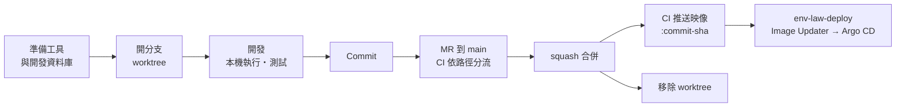

# 參與開發

本檔是從取得程式碼到變更上線的完整流程。各服務的建置、測試指令見 [`AGENTS.md`](AGENTS.md) 與各服務的巢狀 `AGENTS.md`；設計論據在同層的 `env-law-docs` 倉庫；部署清單在同層的 `env-law-deploy` 倉庫。

## 流程總覽



## 1. 準備工具

| 工具 | 版本 | 用途 |
|------|------|------|
| Git | — | |
| Docker 相容的容器執行環境 | — | 開發用 PostgreSQL、Testcontainers、映像建置 |
| .NET SDK | 10.0.401 以上的 10.0 功能版（`services/platform/global.json`） | platform |
| [uv](https://docs.astral.sh/uv/) | CI 用 0.12.18（`.gitlab-ci.yml`） | ontology、consult、`libs/python`；Python 3.14 由 uv 依 `.python-version` 安裝 |
| [Worktrunk](https://worktrunk.dev)（`wt`） | — | 每條分支一棵 worktree，並自動建立該樹的環境 |
| Node.js | — | 以 `npx` 執行 buf（契約 lint 與相容性檢查） |
| [kind](https://kind.sigs.k8s.io)、kubectl | — | 只在驗證 `env-law-deploy` 的清單時需要 |

## 2. 取得程式碼與開發資料庫

三個倉庫放在同一層目錄：`env-law`（本倉庫）、`env-law-docs`、`env-law-deploy`。`env-law-deploy` 的本機叢集腳本預設 `../env-law` 為程式碼位置。

開發用 PostgreSQL 起一次即可，之後各 worktree 共用（見下方「本機開發環境」）。

## 3. 開分支

```bash
wt switch --create <type>/<簡述>     # 如 feat/import-pipeline、fix/…、docs/…
```

`wt` 依 `.config/wt.toml` 建樹：各服務的依賴自動裝好（`uv sync`、`dotnet restore`）。每條分支一棵樹，平行的樹之間 port 與資料庫名都由分支推導，不會相撞。

## 4. 開發與本機執行

```bash
wt ontology    # 建本樹的庫（若無）→ 遷移 → gRPC 伺服器
wt consult     # gRPC 伺服器，指向本樹的 ontology
wt platform    # REST API；Development 會自建本樹的庫並遷移
wt list        # URL 欄是本樹 platform 的位址
```

- **測試、lint、typecheck**：從該服務目錄執行，指令見各服務的 `AGENTS.md`。測試自起 Testcontainers 資料庫，不用開發資料庫。
- **改契約（`proto/`）**：從倉庫根跑 `buf lint` 與 `buf breaking`（指令見 `AGENTS.md`「Commands」）；兩側的產生碼在同一個 MR 更新。破壞性變更開新版本（`v2`），不改 `v1`。
- **加新服務**：依 `AGENTS.md`「目錄配置與擴充判準」。

## 5. Commit

採 [Conventional Commits](https://www.conventionalcommits.org)：`type(scope): 說明`，破壞性變更加 `!`（如 `feat(consult)!: …`）。一個 commit 做一件事；diff 小而聚焦。

## 6. MR 與 CI

推送分支後開 MR 到 `main`。`main` 受保護，不直接推送。

CI 依改動路徑分流，只跑受影響的部分：

| 改動 | 跑什麼 |
|------|--------|
| 任何改動 | `gate`（確保每條 pipeline 都存在，只改文件的 MR 才能合併） |
| `services/platform/` | `dotnet`（建置、測試、格式）、`platform-image` |
| `services/ontology/`、`libs/python/` | `python`（含產生碼是否過期）、`ontology-image` |
| `services/consult/`、`libs/python/` | `consult`、`consult-image` |
| `libs/python/env-law-segmenter/` | `segmenter` |
| `proto/` | `proto`（`buf lint`、對目標分支 `buf breaking`），以及所有消費它的服務 |

非 `main` 分支的映像 job 只驗證能建置，不推送。**pipeline 成功才能合併**；以 squash 合併，合併後刪除來源分支。

## 7. 上線

合併進 `main` 之後不需人工：

1. `<service>-image` 把映像推送為 `:<commit-sha>`。
2. `env-law-deploy` 的 Argo CD Image Updater 偵測到新映像，把 tag commit 進該倉庫。
3. Argo CD 依序同步：資料庫 → 遷移 Job → 服務。

**程式碼與部署清單要一起改時，清單先行**：先在 `env-law-deploy` 合併向後相容的清單（例如新環境變數先給預設值），再合併本倉庫的程式碼。順序反了，新映像會配上舊清單。

**回退是向前修正**：在本倉庫 revert 有問題的 commit，照上述流程重新上線；不要在 `env-law-deploy` 把 tag 改回舊值。

改到 `env-law-deploy` 的 `base/` 時，先在本機 kind 叢集實際套用過再開 MR（見該倉庫的 README「本機叢集」）。

## 8. 收尾

```bash
wt remove <type>/<簡述>     # 刪除 worktree；分支已合併則一併刪除，該樹的開發資料庫也一起刪掉
```

## 設計決策

改動設計時，決策的論據寫進 `env-law-docs`，不寫進本倉庫的 `AGENTS.md` 或本檔：作業規範會隨程式碼改變，論據要留下「當時知道什麼、為什麼這樣選」。

---

## 本機開發環境

兩套環境，用途不同，都只需要一個 Docker 相容的容器執行環境：

| 環境 | 用途 | 資料庫 |
|------|------|--------|
| **主機直跑**（`wt platform`／`wt ontology`／`wt consult`） | 日常開發、除錯 | 容器 `env-law-dev-pg`，`localhost:5432` |
| **kind 叢集** `env-law`（context `kind-env-law`） | 驗證 `env-law-deploy` 的清單 | 叢集內 CloudNativePG `env-law-pg` |

**本機叢集用 kind。** 節點以 Docker 引擎為容器執行環境的 Kubernetes 不支援 ImageVolume，pgvector 掛不上；kind 的節點是 containerd 2.x，清單原樣可用。細節見 `env-law-deploy` 的 README「本機叢集」。

### 主機直跑的 PostgreSQL

與 ontology 測試同一個映像（`services/ontology/tests/conftest.py`），內含 `vector` 與 `btree_gist`：

```bash
docker run -d --name env-law-dev-pg --restart unless-stopped \
  -p 127.0.0.1:5432:5432 -e POSTGRES_PASSWORD=postgres \
  -v env-law-dev-pg:/var/lib/postgresql \
  pgvector/pgvector:0.8.1-pg18
```

資料在具名 volume `env-law-dev-pg`，刪容器不會刪資料；要從零開始就 `docker rm -f env-law-dev-pg && docker volume rm env-law-dev-pg`。只綁 `127.0.0.1`，不對區網開放。

### 帳密與資料庫

以下全是本機值，不是機密；正式區的值都在叢集端建立，不進版控。

| 項目 | 值 | 出處 |
|------|----|------|
| 主機 PostgreSQL | `postgres`／`postgres` @ `localhost:5432` | 上面的 `docker run`；`appsettings.Development.json`、`scripts/worktree-db.py` 以此為準 |
| 主機資料庫（`wt`） | `platform_<branch>`、`ontology_<branch>` | `.config/wt.toml`；`wt` 起服務時建立，刪 worktree 時一併刪除 |
| 主機資料庫（直接 `dotnet run`） | `envlaw_platform` | `appsettings.Development.json`；platform 在 Development 會自建庫並遷移 |
| 內部 token | `dev` | 各服務 Development 設定、`wt` 別名、kind overlay |
| platform 營運者 key（`X-Admin-Key`） | kind：`admin`；主機直跑：未設定，`/admin` 停用 | kind overlay 的 `env-law-platform-admin`；主機要用就以環境變數 `Platform__AdminKeySha256` 給 key 的 SHA-256 hex（例如 `printf admin \| shasum -a 256`） |
| kind 資料庫 | `env_law`（ontology）、`platform`，擁有者皆為 `env_law` | `env-law-deploy` 的 `base/database/`、`base/platform/database.yaml` |
| kind 資料庫密碼 | CloudNativePG 建叢集時隨機產生，存於 `Secret/env-law-pg-app` | 不寫死；超級使用者存取未開啟（CloudNativePG 預設） |

連 kind 的資料庫（本機 5432 已被主機 PostgreSQL 佔用，故轉到 15432）：

```bash
kubectl --context kind-env-law -n env-law port-forward svc/env-law-pg-rw 15432:5432
kubectl --context kind-env-law -n env-law get secret env-law-pg-app -o jsonpath='{.data.password}' | base64 -d
# 以 env_law／上面的密碼連 localhost:15432，資料庫 env_law 或 platform
```
