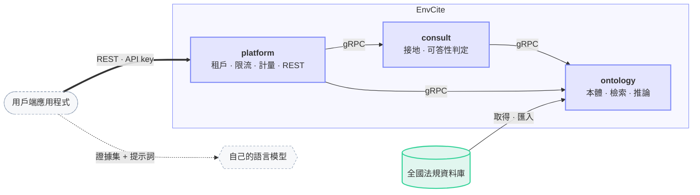

# 環境知識 EnvCite

臺灣環境知識的檢索與引用接地服務：提供可核驗的封閉證據集，證據不足時明確拒答。

## 架構

## 目錄

| 路徑 | 內容 | 文件 |
|------|------|------|
| `proto/` | gRPC 契約 | [README](proto/README.md) |
| `services/platform/` | 控制平面與對外 REST API | [README](services/platform/README.md) · [AGENTS](services/platform/AGENTS.md) |
| `services/ontology/` | 本體，各來源知識的集中處 | [README](services/ontology/README.md) · [AGENTS](services/ontology/AGENTS.md) |
| `services/consult/` | 接地 | [README](services/consult/README.md) · [AGENTS](services/consult/AGENTS.md) |
| `libs/python/` | 共用套件 | [AGENTS](libs/python/AGENTS.md) · [envcite-grpc](libs/python/envcite-grpc/README.md) · [envcite-proto](libs/python/envcite-proto/README.md) · [envcite-segmenter](libs/python/envcite-segmenter/README.md) |

## 文件

- **參與開發**（本機環境、分支、MR 與合併流程）：[`CONTRIBUTING.md`](CONTRIBUTING.md)
- **API 與服務如何組合**：[`proto/README.md`](proto/README.md)
- **開發指引**：[`AGENTS.md`](AGENTS.md)；各服務與 `libs/python/` 另有巢狀 `AGENTS.md`
- **部署與上線**：[`envcite-deploy`](https://gitlab.com/thuaisse-lab/envcite-deploy)（Kubernetes 清單，Argo CD 的唯一來源）
