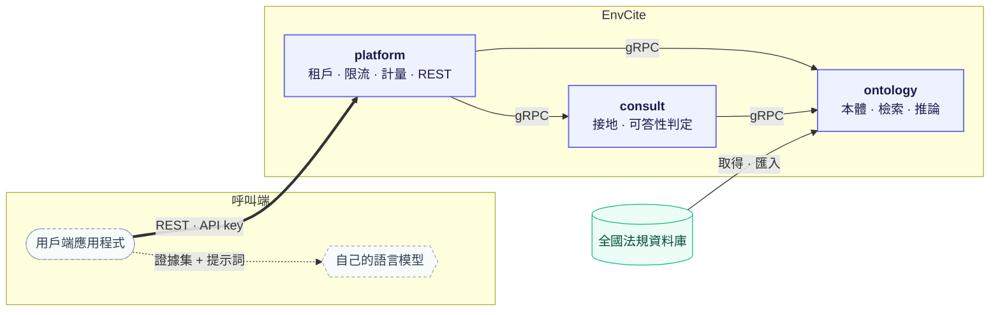

# 環境知識 EnvCite

臺灣環境知識的檢索與引用接地服務：提供可核驗的封閉證據集，證據不足時明確拒答。

## 架構

單一倉庫，各服務獨立建置、獨立部署；服務之間的契約是 [`proto/`](proto/README.md)。

## 目錄

- [`proto/`](proto/README.md)：gRPC 契約
- [`services/platform/`](services/platform/README.md)：控制平面與對外 REST API
- [`services/ontology/`](services/ontology/README.md)：本體，各來源知識的集中處
- [`services/consult/`](services/consult/README.md)：接地
- [`libs/python/`](libs/python/AGENTS.md)：共用套件

## 文件

- **參與開發**（本機環境、分支、MR 與合併流程）：[`CONTRIBUTING.md`](CONTRIBUTING.md)
- **API 與服務如何組合**：[`proto/README.md`](proto/README.md)
- **開發指引**：[`AGENTS.md`](AGENTS.md)；各服務另有巢狀 `AGENTS.md`

## 授權

內部專案，不對外開源。法規資料取自[全國法規資料庫](https://law.moj.gov.tw)，依政府資料開放授權條款－第 1 版使用，須標示出處。
