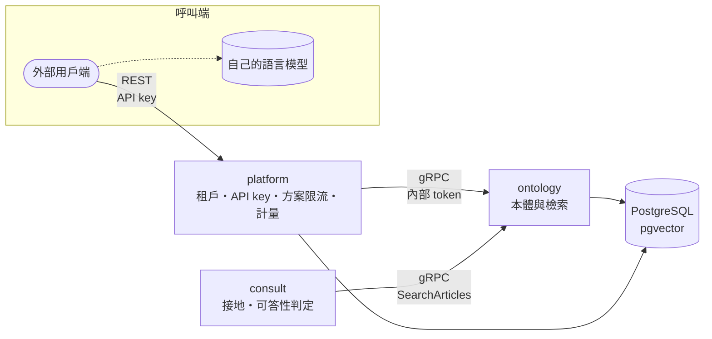

# env-law

環境法規 SaaS。單一倉庫，多個獨立部署的服務。

| 路徑 | 內容 |
|------|------|
| `proto/` | gRPC 契約（唯一真值） |
| `services/platform/` | 多租戶控制平面：租戶、API key、方案與限流、用量計量、對外 REST（C# · .NET 10） |
| `services/ontology/` | 法規範本體與檢索，不分租戶（Python · gRPC） |
| `services/consult/` | 接地：為呼叫端的語言模型備妥可引用的封閉證據集，或拒答（Python · gRPC） |
| `libs/python/` | 服務間共用的 Python 套件：`env-law-grpc`（內部認證）、`env-law-segmenter`（中文分詞） |
| `scripts/`、`.config/wt.toml` | 每棵 worktree 的本機環境（依賴、開發資料庫） |

**API 文件**：[`proto/README.md`](proto/README.md)——服務怎麼組合、呼叫端怎麼接語言模型；欄位語意見各 `.proto` 的註解。

## 呼叫關係

服務之間走 gRPC，以內部 token 認證；platform 與 consult 都以 `dns:///` 加 round_robin 將呼叫分散到 ontology 的各個 pod。

**本系統不執行生成式語言模型。** consult 決定可以引用什麼、能不能答，交出附條文的封閉引用集合（`L1`、`L2`…）；把它寫成答案、並核驗答案只引用該集合，是呼叫端自己的模型與程式的事。做法見 [`proto/README.md`](proto/README.md)。

## 現況

- **platform**：租戶、API key、依方案的限流、用量計量，以及包裝 ontology 的 REST API（`/v1/laws/…`）。方案目前於設定中手動指派，尚未串接計費。
- **ontology**：`GetLaw`、`ListArticles`、`SearchArticles`。檢索目前只有字面比對，語意檢索待嵌入模型選定；資料仍為樣本，全國法規資料庫的匯入管線尚未建立。
- **consult**：`Ground`（`env_law.consult.v2`）已可運作：檢索、接地、可答性判定，回傳證據或拒答。尚未經 platform 對外開放，也尚無容器映像。

開發指引見 [`AGENTS.md`](AGENTS.md)；各服務另有巢狀 `AGENTS.md`。設計論據在同層的 `env-law-docs` 倉庫；Kubernetes 清單（Argo CD 來源）在同層的 `env-law-deploy` 倉庫。

資料來源：全國法規資料庫（政府資料開放授權條款－第1版，需標示出處）。
