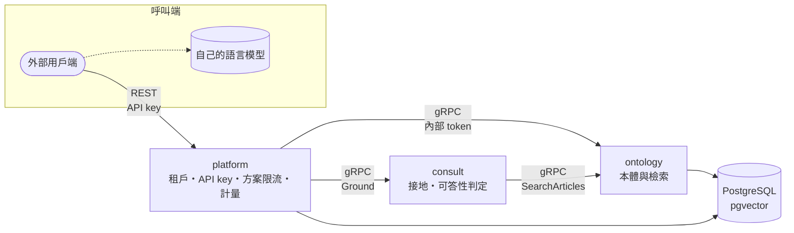

# env-law

環境法規 SaaS。單一倉庫，多個獨立部署的服務。

| 路徑 | 內容 |
|------|------|
| `proto/` | gRPC 契約（唯一真值） |
| `services/platform/` | 多租戶控制平面：租戶、API key、方案與限流、用量計量、對外 REST（C# · .NET 10） |
| `services/ontology/` | 法規範本體與檢索，不分租戶（Python · gRPC） |
| `services/consult/` | 接地：為呼叫端的語言模型備妥可引用的封閉證據集，或拒答（Python · gRPC） |
| `libs/python/` | 服務間共用的 Python 套件：`env-law-grpc`（內部認證、優雅關閉）、`env-law-segmenter`（中文分詞） |
| `scripts/`、`.config/wt.toml` | 每棵 worktree 的本機環境（依賴、開發資料庫） |

**API 文件**：[`proto/README.md`](proto/README.md)——服務怎麼組合、呼叫端怎麼接語言模型；欄位語意見各 `.proto` 的註解。

## 呼叫關係



服務之間走 gRPC，以內部 token 認證；platform 與 consult 都以 `dns:///` 加 round_robin 將呼叫分散到 ontology 的各個 pod。

**本系統不執行生成式語言模型。** consult 決定可以引用什麼、能不能答，交出附條文的封閉引用集合（`L1`、`L2`…）；把它寫成答案、並核驗答案只引用該集合，是呼叫端自己的模型與程式的事。做法見 [`proto/README.md`](proto/README.md)。

## 現況

- **platform**：租戶、API key、依方案的限流、用量計量，以及包裝內部服務的 REST API：`/v1/laws/…`（ontology）、`POST /v1/ground`（consult）。有映像，部署清單在 env-law-deploy。方案目前於設定中手動指派，尚未串接計費。
- **ontology**：`GetLaw`、`ListArticles`、`SearchArticles`。檢索目前只有字面比對，語意檢索待嵌入模型選定；資料仍為樣本，全國法規資料庫的匯入管線尚未建立。
- **consult**：`Ground`（`env_law.consult.v2`）已可運作：檢索、接地、可答性判定，回傳證據或拒答；外部經 platform 的 `POST /v1/ground` 呼叫。

開發指引見 [`AGENTS.md`](AGENTS.md)；各服務另有巢狀 `AGENTS.md`。設計論據在同層的 `env-law-docs` 倉庫；Kubernetes 清單（Argo CD 來源）在同層的 `env-law-deploy` 倉庫。

資料來源：全國法規資料庫（政府資料開放授權條款－第1版，需標示出處）。

## 本機開發環境

兩套環境，用途不同，都跑在 [OrbStack](https://orbstack.dev) 的 Docker 上：

| 環境 | 用途 | 資料庫 |
|------|------|--------|
| **主機直跑**（`wt platform`／`wt ontology`／`wt consult`） | 日常開發、除錯 | 容器 `env-law-dev-pg`，`localhost:5432` |
| **kind 叢集** `env-law`（context `kind-env-law`） | 驗證 `env-law-deploy` 的清單 | 叢集內 CloudNativePG `env-law-pg` |

**OrbStack 內建的 Kubernetes 保持關閉**（`orbctl config set k8s.enable false`）。它以 Docker 引擎為容器執行環境，不支援 ImageVolume，pgvector 掛不上；kind 的節點是 containerd 2.x，清單原樣可用。細節見 `env-law-deploy` 的 README「本機叢集」。

### 主機直跑的 PostgreSQL

與 ontology 測試同一個映像（`services/ontology/tests/conftest.py`），內含 `vector` 與 `btree_gist`：

```bash
docker run -d --name env-law-dev-pg --restart unless-stopped \
  -p 127.0.0.1:5432:5432 -e POSTGRES_PASSWORD=postgres \
  -v env-law-dev-pg:/var/lib/postgresql \
  pgvector/pgvector:0.8.1-pg18
```

資料在具名 volume `env-law-dev-pg`，刪容器不會刪資料；要從零開始就 `docker rm -f env-law-dev-pg && docker volume rm env-law-dev-pg`。只綁 `127.0.0.1`，不對區網開放。

### 帳密與資料庫

以下全是本機值，不是機密；正式區的值都在叢集端建立，不進版控。

| 項目 | 值 | 出處 |
|------|----|------|
| 主機 PostgreSQL | `postgres`／`postgres` @ `localhost:5432` | 上面的 `docker run`；`appsettings.Development.json`、`scripts/worktree-db.py` 以此為準 |
| 主機資料庫（`wt`） | `platform_<branch>`、`ontology_<branch>` | `.config/wt.toml`；`wt` 起服務時建立，刪 worktree 時一併刪除 |
| 主機資料庫（直接 `dotnet run`） | `envlaw_platform` | `appsettings.Development.json`；platform 在 Development 會自建庫並遷移 |
| 內部 token | `dev` | 各服務 Development 設定、`wt` 別名、kind overlay |
| platform 營運者 key（`X-Admin-Key`） | kind：`admin`；主機直跑：未設定，`/admin` 停用 | kind overlay 的 `env-law-platform-admin`；主機要用就以環境變數 `Platform__AdminKeySha256` 給 key 的 SHA-256 hex（例如 `printf admin \| shasum -a 256`） |
| kind 資料庫 | `env_law`（ontology）、`platform`，擁有者皆為 `env_law` | `env-law-deploy` 的 `base/database/`、`base/platform/database.yaml` |
| kind 資料庫密碼 | CloudNativePG 建叢集時隨機產生，存於 `Secret/env-law-pg-app` | 不寫死；超級使用者存取未開啟（CloudNativePG 預設） |

連 kind 的資料庫（本機 5432 已被主機 PostgreSQL 佔用，故轉到 15432）：

```bash
kubectl --context kind-env-law -n env-law port-forward svc/env-law-pg-rw 15432:5432
kubectl --context kind-env-law -n env-law get secret env-law-pg-app -o jsonpath='{.data.password}' | base64 -d
# 以 env_law／上面的密碼連 localhost:15432，資料庫 env_law 或 platform
```
