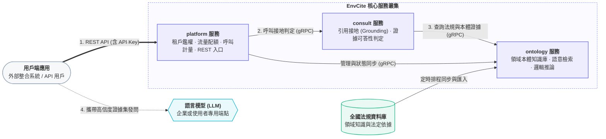

# 臺灣環境知識檢索與引用接地服務 (envcite)

[](https://gitlab.com/thuaisse-lab/envcite/-/pipelines)

> 提供高可靠、可核驗的封閉證據集檢索與引用接地（Grounding）服務；在證據不足時明確拒答，防範模型幻覺。

---

## 服務架構與數據流



---

## 核心服務劃分

| 服務模組 | 協定與職責 | 詳細文件 |
|----------|------------|----------|
| **`platform`** | 對外 REST API 閘道、API Key 授權驗證、租戶配額限流與計量統計 | [platform/README.md](services/platform/README.md) |
| **`consult`** | 引用接地核心引擎、證據充分性檢驗、封閉證據集建立與可答性防護 | [consult/README.md](services/consult/README.md) |
| **`ontology`** | 環境領域本體論模型、跨來源法規知識集中存儲、混合向量檢索與推論 | [ontology/README.md](services/ontology/README.md) |
| **`proto`** | 跨微服務內部 gRPC 介面定義契約 (Protocol Buffers) | [proto/README.md](proto/README.md) |
| **`libs/python`** | 內部通用 Python 套件（含 gRPC client/server 封裝、斷詞工具等） | [libs/python/AGENTS.md](libs/python/AGENTS.md) |

---

## 儲存庫結構

```text
envcite/
├── proto/                         # 微服務間 gRPC 接口定義
├── services/                      # 微服務核心實作
│   ├── platform/                  # API Gateway / 租戶管理 / REST 端點
│   ├── consult/                   # 引用接地與可答性邏輯
│   └── ontology/                  # 知識本體庫與檢索引擎
├── libs/                          # 共用內部套件庫
│   └── python/                    # Python 共用模組 (envcite-grpc, segmenter 等)
├── CONTRIBUTING.md                # 參與開發、分支與測試流程指引
├── AGENTS.md                      # AI 與開發者架構規範準則
└── README.md                      # 專案概覽與架構指引
```

---

## 開發與參考文件

- **參與開發**（本機開發環境、分支策略、MR 合併流程）：[`CONTRIBUTING.md`](CONTRIBUTING.md)
- **API 與服務契約**：[`proto/README.md`](proto/README.md)
- **架構規範與開發準則**：[`AGENTS.md`](AGENTS.md)（各微服務子目錄亦提供專屬規範）
- **部署配置**：由獨立的 GitOps 部署庫 [`envcite-deploy`](../envcite-deploy) 提供宣告式 Kubernetes 清單
