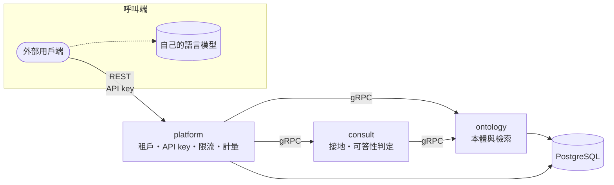

# env-law

臺灣環境法規的檢索與引用接地（grounding）服務：把法規條文組織成可檢索的本體，並為呼叫端的語言模型備妥可核驗的封閉證據集；證據不足時，明確拒答。

本倉庫是單一倉庫（monorepo），收納多個服務；各服務仍獨立建置、獨立部署。

## 特性

- **條文級檢索**：以法規與條文為單位查詢與檢索，資料取自全國法規資料庫。
- **封閉引用集合**：回傳附條文的有序證據集，呼叫端只能以代號引用，引用可被機械核驗。
- **可答性判定**：由規則決定能否回答；證據不足時回傳拒答，而非勉強生成。
- **不綁定模型**：本系統不執行生成式語言模型，呼叫端自選模型與提示詞。
- **多租戶存取控制**：以 API key 識別租戶，並限流、計量。
- **契約優先**：gRPC 契約（`proto/`）是服務介面的唯一真值，並有相容性檢查。

## 架構

| 路徑 | 內容 |
|------|------|
| `proto/` | gRPC 契約（唯一真值） |
| `services/platform/` | 多租戶控制平面：租戶、API key、限流、計量，以及對外 REST API（C#） |
| `services/ontology/` | 法規本體與檢索，不分租戶（Python） |
| `services/consult/` | 接地：為呼叫端的語言模型備妥可引用的封閉證據集，或拒答（Python） |
| `libs/` | 服務間共用的程式庫 |

外部用戶端只經 platform 的 REST API 進入；服務之間走 gRPC，認證由叢集的服務網格（mTLS 加授權政策）負責，服務本身不驗證呼叫端。

**語言模型不在本系統之內。** consult 決定可以引用什麼、能不能答，並交出附條文的封閉引用集合；把它寫成答案、並核驗答案只引用該集合，是呼叫端自己的模型與程式的責任。整合方式見 [`proto/README.md`](proto/README.md)。

## 快速開始

本機開發環境的建置、資料庫與常用指令見 [`CONTRIBUTING.md`](CONTRIBUTING.md)。

## 文件

- **API**：[`proto/README.md`](proto/README.md) 說明服務如何組合、呼叫端如何接上語言模型；欄位語意見各 `.proto` 的註解。
- **開發指引與各服務現況**：[`AGENTS.md`](AGENTS.md)；各服務另有巢狀 `AGENTS.md`。

## 貢獻與回報

分支、MR 與合併流程見 [`CONTRIBUTING.md`](CONTRIBUTING.md)；問題與需求請開 GitLab issue。

## 授權

本倉庫為組織內部專案，不對外開源；程式碼與文件僅供組織內部使用。

法規資料取自[全國法規資料庫](https://law.moj.gov.tw)，依政府資料開放授權條款－第 1 版使用，須標示出處。
