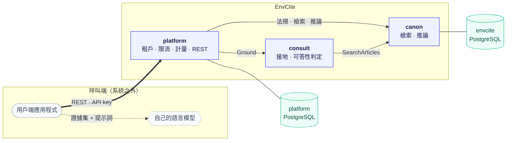
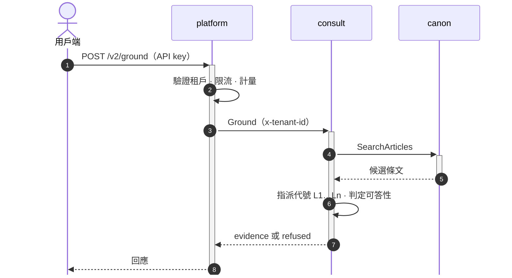

<!--
type: reference
applies-to: all
owns: [service-composition, grpc-metadata, as-of-semantics, grpc-error-reasons, red-metrics, caller-grounding, reasoning-api]
-->

# envcite API

gRPC 契約，`buf` 單一模組（根為本目錄）；欄位與方法的語意見 `.proto` 註解。回[倉庫總覽](../README.md)。

- **內部 gRPC 套件**：`envcite.canon.v1`（共享，實作在 [`services/canon`](../services/canon/README.md#概念)）與 `envcite.consult.v3`（租戶隔離，實作在 [`services/consult`](../services/consult/README.md#概念)）。
- **對外 REST 介面**：僅經 [`platform`](../services/platform/README.md) 暴露，契約為 [`services/platform/openapi/openapi_v2.json`](../services/platform/openapi/openapi_v2.json)。Python 產生碼見 [`libs/python/envcite-proto`](../libs/python/envcite-proto/README.md)。
- **檢查與規則**：`buf lint`／`buf breaking` 指令見倉庫根 [`AGENTS.md`](../AGENTS.md) 的 Commands；產生碼與破壞性變更規則見同檔 Contract。

## 概念

| 層 | 節 | 這裡有 |
|----|----|--------|
| 組合 | [服務如何組合](#服務如何組合) | 誰呼叫誰、兩份資料庫、模型在系統外 |
| 組合 | [一次接地請求](#一次接地請求) | `Ground` 的訊息順序 |
| 約定 | [約定](#約定) | metadata、法規識別、`as_of`、錯誤原因、RED |
| 呼叫端 | [呼叫端的語言模型](#呼叫端的語言模型) | 本系統不生成；證據怎麼交、輸出怎麼核 |
| 推論 | [標註與推論](#標註與推論) | `ListStatements`、`Evaluate` 的界線 |

## 服務如何組合

外部用戶端只經 platform 的 REST API 進入；服務之間走 gRPC，服務本身不驗證呼叫端，僅由部署環境限制呼叫來源（部署庫）。

### 一次接地請求

取得證據後的模型呼叫與輸出核驗由呼叫端負責，見〈[呼叫端的語言模型](#呼叫端的語言模型)〉。

## 約定

### Metadata

| key | 必填 | 說明 |
|-----|------|------|
| `x-tenant-id` | `consult` 必填 | 配額與稽核（`consult` 缺少 → `INVALID_ARGUMENT`）；`canon` 只用於日誌 |
| `x-request-id` | 否 | 只用於日誌 |

### 法規識別與 `as_of`

- **複合自然鍵 `LawIdentifier`**：由 `jurisdiction`、`id_scheme`、`local_id` 組成（取值見 `canon.proto` 註解）。三欄皆必填且無預設值：缺任一欄回 `INVALID_ARGUMENT`（`EMPTY`）；值不在封閉集合內回 `INVALID_ARGUMENT`（`UNKNOWN_VALUE`）；管轄與方案配對不合法（地方方案目前為契約預留）於語料中不存在，查詢回 `LAW_NOT_FOUND`。
- **`SearchArticles.jurisdiction`**：過濾條件，留空查全部管轄，有值須為合法管轄。
- **`as_of`**：ISO 8601 日期（依該日施行條文；空字串為現行）。無任何版本涵蓋該日時回查無，不退回現行條文。

### 狀態碼與錯誤原因

每個錯誤皆為標準 gRPC 狀態碼搭配 `google.rpc.ErrorInfo`（`domain = "canon.envcite"`，`reason` 為 `UPPER_SNAKE_CASE`）；呼叫端依 `reason` 分流，不解析訊息文字。`INVALID_ARGUMENT` 另帶 `google.rpc.BadRequest` 一次回報所有違規欄位路徑。可用 `grpcio-status`（Python）或 `Google.Api.CommonProtos`（.NET）解開 trailing metadata。

| 狀態碼 | `reason` | 時機 | 重試 |
|--------|----------|------|------|
| `INVALID_ARGUMENT` | `INVALID_REQUEST` | 參數不合法、缺 `x-tenant-id`；`BadRequest` 原因含 `EMPTY`、`UNKNOWN_VALUE`、`INVALID_DATE`、`OUT_OF_RANGE`、`DATE_ORDER`、`RESERVED_CONCEPT`、`INVALID_NUMBER`、`UNSET` | 否 |
| `NOT_FOUND` | `LAW_NOT_FOUND` | 語料無此法規 | 否 |
| `NOT_FOUND` | `AS_OF_NOT_COVERED` | 法規存在但無版本涵蓋 `as_of` | 否 |
| `RESOURCE_EXHAUSTED` | `BUSY` | `Evaluate` 等不到名額，或讀取等不到資料庫連線 | 是，退避 |
| `DEADLINE_EXCEEDED` | `EVALUATION_TIMEOUT` | 推論期限用完，資料庫查詢被取消 | 視預算 |
| `DEADLINE_EXCEEDED` | `READ_TIMEOUT` | 讀取期限用完，資料庫查詢被取消 | 視預算 |
| `UNAVAILABLE`、`DEADLINE_EXCEEDED` | — | 下游不可用或逾時 | 是 |

`consult` 呼叫 `canon` 時，原樣轉出 `canon` 的狀態碼。

### RED 指標

- **定義**：每個一元呼叫於兩側各有耗時直方圖（次數 = rate，`rpc.response.status_code != OK` = errors，分布 = duration）。
- **對照標籤**：`rpc.service`、`rpc.method`、`rpc.response.status_code`（租戶與案件內容不進標籤；匯出開關依倉庫根 [`AGENTS.md`](../AGENTS.md)）。
- **真值位置**：`canon` 伺服器端在 `libs/python/envcite-grpc/src/.../metrics.py`；`consult` 伺服器端在 `services/consult/.../GrpcServerMetrics.cs`；.NET 用戶端與共用約定在 `libs/dotnet/.../GrpcClientMetrics.cs`、`RpcMetrics.cs`；對外 HTTP 接線在 `libs/dotnet/.../Telemetry.cs`。

## 呼叫端的語言模型

**本系統不執行生成式模型**：系統只決定可引用內容與可答性，散文生成與輸出核驗由呼叫端執行。

### 檢索與知識介面

| RPC | 用途與契約重點 |
|-----|----------------|
| `Ground` | **作答唯一入口**。由 `consult` 判定可答性並回傳 `evidence`（上限內依相關度排序）或 `refused`。`sources` 留空為查全部來源，不認得代號回 `INVALID_ARGUMENT` |
| `SearchArticles` | 混合檢索（字面臂 + 語意臂；`lexical_score` 與 `semantic_similarity` 僅限單次查詢內比較）。`term_coverage` 供呼叫端過濾低覆蓋命中，不改名次。`include_guidance` 可經有效函釋帶出條文（`guidance_documents` 標出件數）；`rerank` 啟用精排並回 `rerank_score`（無模型、滿載或逾時皆無聲退回原次序且不設分數）。問句含法規全名時先限縮至該法規，無命中才改查全庫 |
| `ListInvalidations` | 回傳 `as_of` 當日因大法官解釋或憲法法庭判決失效之條文單元（`partial` 為真時僅部分失效，範圍見原文）。**未列出不代表未失效**（寫法含糊者保守不自動提出）；顯示須標示憲法法庭出處 |
| `ListLaws` | 依 `as_of`、`jurisdiction` 與 `category_prefix`（單一大寫字母）列出有效法規摘要（含 `document_type`、`child_count`、`parent_count`、`guidance_count`） |
| `GetLawGraph` | 依焦點法規展開多母法 DAG（`upstream_depth`／`downstream_depth` 上限 4，`child_limit` 上限 60）、義務罰則連動（`violation_links`）、有效函釋（`guidance_links`）與子法分組計數（`child_groups`）；未指定焦點則回傳核心母法總覽子圖。`invalidation_count` 顯示須標示憲法法庭出處 |

### 證據引用與輸出核驗步驟

1. **傳送原句**：`GroundRequest.question` 與 `SearchArticlesRequest.query` 一律傳使用者原句，不先改寫。
2. **分流回應**：`outcome` 必為 `evidence` 或 `refused`。拒答是正常結果，不重試、不呼叫模型；若因詢問自治法規遭拒（`REASON_LOCAL_LAW_UNCOVERED`），見 [`platform` 的「語料範圍」](../services/platform/README.md#語料範圍)。
3. **封閉引用**：`evidence` 內每筆以來源代號（如法規 `L1`…，依來源領取字母且單次回應內連續）開頭，`Citation.source` 標明出處。Prompt 須限定模型只能引用清單內的 `[L1]` 代號。
4. **輸出核驗**：比對模型輸出中的引用代號，剝除不在封閉集合內的代號；若剝除後無任何引用，視同拒答。
5. **出處呈現**：以 `Citation.iri` 呈現條文版本出處；代號僅於單次回應有效，不得持久化儲存。

## 標註與推論

`ReasoningService`（`envcite.canon.v1`）唯讀提供規範標註與**候選**推論結論；未通過驗證閘門的陳述不參與推論（無確認標註時 `verdicts` 為空）。數值一律用 `Decimal`（十進位文字），日期用 ISO 8601 字串，列舉零值皆為 `*_UNSPECIFIED`。

### `ListStatements`

回傳 `(identifier, as_of)` 當日有效且已確認的陳述：`Requirement.any_of` 為「或」、`Disjunct.all_of` 為「且」；委由授權命令之門檻以 `Delegation` 表示，不在此解析。

### `Evaluate`

輸入 `conduct_on`（行為日）、`decided_on`（裁處日）與案件事實，回傳 `at_decision`（裁處時法，行政罰法 §5 原則）與 `earlier`（行為日至裁處日間陳述組不同之時點，不代選「最有利」）。期限同時為資料庫查詢上限，等不到名額回 `BUSY`。

1. **事實輸入**：`AdministrativePenaltyFacts` 欄位缺席視為「未知」而非「否」；概念代碼以 `ap_` 開頭者回 `RESERVED_CONCEPT`。
2. **語料與失效邊界**：
   - `Outcome.uncovered_law_identifiers` 列出該日已制定但語料無版本之法規，**不可將 `earlier` 的空 `verdicts` 解讀為行為時合規**。
   - 違憲失效版本不參與推論，列於 `Outcome.invalidated`（限值條文失效附 `PROBLEM_KIND_INVALIDATED_DELEGATION`）。
   - `Outcome.guidance`（行政規則）與 `Outcome.court_decisions`（行政法院裁判）僅附在結果旁供參考，非推論前提。裁判以裁處日不早於裁判日、且錨點為陳述所讀文字來附上；個別案件的拘束不改結論。
3. **管制量值與認定方式**：委由個別處分（`Condition.delegate_permit`）之量值放 `permit_limits`（缺漏列於 `Outcome.missing_permit_limits`）；限值有標 `measurement_method`／`averaging_period` 時須與事實一致（否則 `PROBLEM_KIND_MEASUREMENT_MISMATCH`），未標者照常比對並附 `PROBLEM_KIND_MEASUREMENT_UNLABELED`。
4. **責任基礎、前置罰則與授權鏈**：
   - `Slot.liability_basis` 與 `actor_bases` 有交集則主體成立，無交集列於 `Outcome.subject_mismatch`，未提供則附條件並於 `Outcome.missing` 報缺 `liability_basis`；任一未標則不受限。
   - 前置罰則（`Sanction.triggers`）僅於前提成立時列出（`PenaltyCandidate.triggered_by`）。
   - 授權鏈列於 `Outcome.delegation_bases`，`rooted = false` 時相關罰則附條件。
5. **行政罰法總則（§18、§26）**：`criminal_offense` 為真且無 `criminal_cleared_on` 時，罰鍰列於 `GeneralPart.unpunished`（`EXCUSE_CRIMINAL_PRIORITY`）；`reduced`、`raised_caps` 與 `criminal_deductions` 只給額度，不代選罰鍰額。
