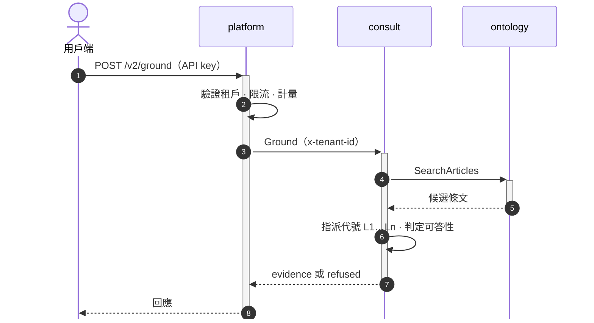
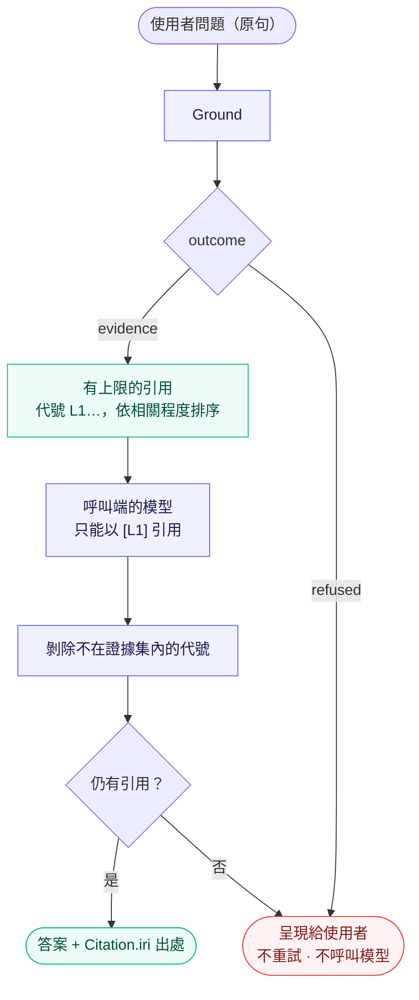

# envcite API

gRPC 契約，`buf` 單一模組（根為本目錄）；欄位與方法的語意見 `.proto` 註解。回[倉庫總覽](../README.md)。

| 套件 | 服務 | 租戶 | 對象 | 實作 |
|------|------|------|------|------|
| `envcite.ontology.v1` | `OntologyService`、`ReasoningService` | 共享 | 內部 | [`services/ontology`](../services/ontology/README.md) |
| `envcite.consult.v2` | `ConsultationService` | 隔離 | 內部 | [`services/consult`](../services/consult/README.md) |

外部用戶端只經 [`platform`](../services/platform/README.md) 的 REST：契約是 [`services/platform/openapi/openapi_v2.json`](../services/platform/openapi/openapi_v2.json)。Python 產生碼見 [`libs/python/envcite-proto`](../libs/python/envcite-proto/README.md)。

```bash
buf lint
buf breaking --against '.git#branch=main'
```

產生碼與破壞性變更的規則見倉庫根 [`AGENTS.md`](../AGENTS.md) 的 Contract。

## 服務如何組合


外部用戶端只經 platform 的 REST API 進入；服務之間走 gRPC，認證由叢集的服務網格（mTLS 加授權政策）負責，服務本身不驗證呼叫端。

### 一次接地請求



拿到回應之後的事——把證據交給模型、核驗它的輸出——是呼叫端的責任，見〈呼叫端的語言模型〉。

## 約定

**Metadata**（服務間認證由叢集的服務網格〔mTLS 加授權政策〕負責，服務本身不驗證呼叫端）

| key | 必填 | 說明 |
|-----|------|------|
| `x-tenant-id` | consult 必填 | 配額與稽核；ontology 只用於日誌。consult 缺少 → `INVALID_ARGUMENT` |
| `x-request-id` | 否 | 只用於日誌 |

**`as_of`**：ISO 8601 日期，依哪一天施行的條文；空字串為現行。沒有任何版本涵蓋該日時回**查無**，不回現行條文。

**狀態碼與錯誤原因**

每個錯誤是標準狀態碼加一個 `google.rpc.ErrorInfo`（`domain` 為 `ontology.envcite`，`reason` 為 UPPER_SNAKE_CASE）。呼叫端依 `reason` 分流，不解析訊息文字。`INVALID_ARGUMENT` 另帶 `google.rpc.BadRequest`，每個違規欄位一列（`field` 為欄位路徑，如 `facts[2].values[0].number.value`），全部一次回報。細節在 trailing metadata：用 `grpcio-status`（Python）或 `Google.Api.CommonProtos` 的 `Status` 解開；不解開也不影響狀態碼的語意。

| 狀態碼 | `reason` | 何時 | 重試 |
|--------|----------|------|------|
| `INVALID_ARGUMENT` | `INVALID_REQUEST` | 參數不合法、缺 `x-tenant-id`；欄位原因在 `BadRequest`：`EMPTY`、`INVALID_DATE`、`OUT_OF_RANGE`、`DATE_ORDER`、`RESERVED_CONCEPT`、`INVALID_NUMBER`、`UNSET` | 否 |
| `NOT_FOUND` | `LAW_NOT_FOUND` | 語料沒有這部法規 | 否 |
| `NOT_FOUND` | `AS_OF_NOT_COVERED` | 法規存在，但沒有版本涵蓋 `as_of` | 否 |
| `RESOURCE_EXHAUSTED` | `BUSY` | `Evaluate` 在呼叫的期限內等不到名額 | 是，退避 |
| `DEADLINE_EXCEEDED` | `EVALUATION_TIMEOUT` | 期限用完，資料庫查詢被取消 | 視預算 |
| `UNAVAILABLE`、`DEADLINE_EXCEEDED` | — | 下游不可用或逾時 | 是 |

consult 呼叫 ontology 時，ontology 的狀態碼原樣轉出。

**RED 指標**（rate、errors、duration）：每個一元呼叫在兩側各有一個耗時直方圖，次數是 rate、`rpc.response.status_code` 不是 `OK` 的是 errors，分布是 duration；兩側用同一組標籤（`rpc.service`、`rpc.method`、`rpc.response.status_code`），所以能對照。租戶與案件內容不進標籤。沒設 `OTEL_EXPORTER_OTLP_ENDPOINT` 就不匯出。名稱與標籤的真值在程式碼，不在文件：伺服器端是 `libs/python/envcite-grpc` 的 `metrics.py`；platform 的用戶端是 `services/platform` 的 `GrpcClientMetrics.cs`；對外 HTTP 是 ASP.NET Core 標準的伺服器請求指標，接線在 `Observability.cs`。

## 呼叫端的語言模型

**本系統不執行生成式模型。** 它決定可以引用什麼、能不能回答，並交出證據；寫成散文的是呼叫端自己的模型。

要作答，呼叫 **`Ground`**，不要自己拿 `SearchArticles` 的結果給模型：檢索永遠回最佳的幾筆，即使語料裡毫無相關內容，「有沒有答案」的判斷由 consult 做掉。

`SearchArticles` 是混合檢索：字面臂與語意臂以名次倒數融合排序。`lexical_score` 是字面臂的原始分數（沒命中為 0），`semantic_similarity` 是語意臂的餘弦相似度（沒命中或未啟用語意臂則不設）；兩者都只在同一次查詢之內可比較，順序不由任一分數決定。consult 的相關性下界只以 `lexical_score` 校準：只由語意臂召回的條不進入接地證據，要等語意分數也校準過。



- `question` 傳使用者原句，不要先改寫；`SearchArticles` 的 `query` 同樣傳原文，斷詞由服務做。
- 回應的 `outcome` 恰有一個：`evidence`（有筆數上限的引用，依相關程度排序）或 `refused`（拒答）。拒答是結果，不是錯誤：呈現給使用者，不重試、不呼叫模型。
- 交給模型時，證據以代號（`L1`…）開頭，限定模型只能以 `[L1]` 引用。代號的字母是來源本體的（法規本體 `law` 為 `L`），每筆 `Citation.ontology` 標明出處；每個本體各領一個字母，序號在整份證據內連續。
- `GroundRequest.ontologies` 指定要查哪些本體，留空為全部；不認得的代號回 `INVALID_ARGUMENT`。
- 模型輸出要核驗：代號集合是封閉的，比對字串即可，剝除不在集合內的代號；剝除後沒有任何引用，視同拒答。
- 以 `Citation.iri`（條文版本的 IRI）呈現出處；代號只在單次回應內有意義，不要儲存。

## 標註與推論

`ReasoningService`（`envcite.ontology.v1`）唯讀地提供規範標註與由它推出的**候選**結論。它不判決：沒有通過驗證閘門的陳述不產生任何結論，沒有確認的標註時 `verdicts` 為空。

- **`ListStatements(law_id, as_of)`**：某日有效、已確認的陳述。`Statement` 的要件是析取範式（`Requirement.any_of` 是「或」，`Disjunct.all_of` 是「且」）；委由授權命令的門檻值以 `Delegation` 表示，不在這裡解析。
- **`Evaluate`**：給 `conduct_on`（行為日）、`decided_on`（裁處日）與案件事實。回傳 `at_decision`（裁處時之法律，行政罰法第 5 條的預設），`earlier` 是行為日到裁處日之間陳述組與裁處時不同的法律，**不替呼叫端選「最有利」**。
  - 案件事實：一般概念用 `Fact`（一個概念可有多個值，矛盾會被回報，不被消解）；值是數字、布林，或 `concept`（概念取某個值概念，與以 `value_concept` 比較的要件對應，只有 `eq`／`ne`；「屬於」只依該法現行的用語定義判定，沒有定義涵蓋視為不屬於）；行政罰法總則的事實用 `AdministrativePenaltyFacts`，欄位缺席是「未知」，不是「否」。代碼以 `ap_` 開頭的 `Fact` 被拒絕（`RESERVED_CONCEPT`）。
  - 結論：`Verdict`、`PenaltyCandidate`、缺的事實（`missing`）、需判斷的要件（`needs_assessment`）、矛盾與未決的衝突都分開列；`sources` 給每個陳述所讀的條文版本 IRI。
  - `LEGAL_EFFECT_ORDER`（改善命令等）不是行政罰，行政罰法總則的排除、減輕、時效與一行為不適用於它；`PenaltyCandidate.discretionary` 是條文寫「得」的效果裁量，與要件的 `needs_assessment` 是兩個層次。
  - **語料的歷史有起點。** 全國法規資料庫只有現行全文，早於語料持有的第一個版本的日子，該法規的規定不在結果裡。`Outcome.uncovered_law_ids` 列出「那天已制定、但語料沒有當時版本」的法規：它們的規定缺席，不代表當時沒有規定。`earlier` 裡出現空的 `verdicts` 時先看這個欄位，不要解讀成行為時合規。
  - **行政規則附在結果旁，不是推論的前提。** `Outcome.guidance` 是主管機關對結論所依條文的函釋、裁量基準等（行政程序法第 159 條）：拘束機關內部、不直接拘束人民與法院。以 `decided_on` 判斷是否已發布、尚未停止適用（釋字第 287 號：解釋性規定闡明法規原意，行為早於發文的未確定案件也附上），且所解釋的須正是陳述所讀的那段文字；`earlier` 各組同樣以裁處日判斷。
  - 預算：期限同時是資料庫查詢的上限；同一時間只有少數 `Evaluate` 能執行，等不到名額回 `BUSY`。
- **數值**用 `Decimal`（十進位文字），**日期**維持 ISO 8601 字串；列舉的零值一律是 `*_UNSPECIFIED`，收到就是契約之外的值。
