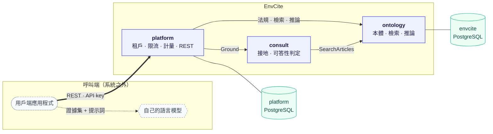
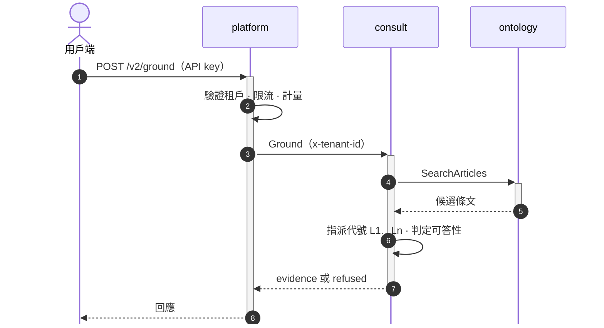

<!--
type: reference
applies-to: all
owns: [service-composition, grpc-metadata, as-of-semantics, grpc-error-reasons, red-metrics, caller-grounding, reasoning-api]
-->

# envcite API

gRPC 契約，`buf` 單一模組（根為本目錄）；欄位與方法的語意見 `.proto` 註解。回[倉庫總覽](../README.md)。

套件 `envcite.ontology.v2`（共享，實作在 [`services/ontology`](../services/ontology/README.md#概念)）與 `envcite.consult.v2`（租戶隔離，實作在 [`services/consult`](../services/consult/README.md#概念)）皆為內部介面。外部用戶端只經 [`platform`](../services/platform/README.md) 的 REST，契約是 [`services/platform/openapi/openapi_v2.json`](../services/platform/openapi/openapi_v2.json)。Python 產生碼見 [`libs/python/envcite-proto`](../libs/python/envcite-proto/README.md)。

`buf lint`、`buf breaking` 的指令見倉庫根 [`AGENTS.md`](../AGENTS.md) 的 Commands；產生碼與破壞性變更的規則見同檔的 Contract。

## 概念

| 層 | 節 | 這裡有 |
|----|----|--------|
| 組合 | [服務如何組合](#服務如何組合) | 誰呼叫誰、兩份資料庫、模型在系統外 |
| 組合 | [一次接地請求](#一次接地請求) | `Ground` 的訊息順序 |
| 約定 | [約定](#約定) | metadata、法規識別、`as_of`、錯誤原因、RED |
| 呼叫端 | [呼叫端的語言模型](#呼叫端的語言模型) | 本系統不生成；證據怎麼交、輸出怎麼核 |
| 推論 | [標註與推論](#標註與推論) | `ListStatements`、`Evaluate` 的界線 |

## 服務如何組合

外部用戶端只經 platform 的 REST API 進入；服務之間走 gRPC，服務本身不驗證呼叫端，只准指定服務呼叫由部署環境執行（部署庫）。

### 一次接地請求

拿到回應之後的事——把證據交給模型、核驗它的輸出——是呼叫端的責任，見〈呼叫端的語言模型〉。

## 約定

**Metadata**

| key | 必填 | 說明 |
|-----|------|------|
| `x-tenant-id` | consult 必填 | 配額與稽核；ontology 只用於日誌。consult 缺少 → `INVALID_ARGUMENT` |
| `x-request-id` | 否 | 只用於日誌 |

**法規識別**：法規以複合自然鍵 `LawIdentifier`（`jurisdiction`、`id_scheme`、`local_id`）標識，ontology 的請求與回應都用它，不用單一字串的法規代號；三個欄位的取值與語意見 `ontology.proto` 的註解。三個欄位都必填，沒有預設管轄或方案：缺任一個回 `INVALID_ARGUMENT`（欄位原因 `EMPTY`），值不在 `.proto` 註解列的封閉集合內也是 `INVALID_ARGUMENT`（`UNKNOWN_VALUE`）。管轄與方案的配對由資料庫強制（中央方案只配 `TW-CENTRAL`、地方方案只配縣市），不合法的配對不存在於語料，查詢回 `LAW_NOT_FOUND`。地方方案與縣市管轄是契約預留，目前沒有取得來源。`SearchArticles.jurisdiction` 是過濾條件：留空為全部管轄，有值須是合法管轄。

**`as_of`**：ISO 8601 日期，依哪一天施行的條文；空字串為現行。沒有任何版本涵蓋該日時回**查無**，不回現行條文。

**狀態碼與錯誤原因**

每個錯誤是標準狀態碼加一個 `google.rpc.ErrorInfo`（`domain` 為 `ontology.envcite`，`reason` 為 UPPER_SNAKE_CASE）。呼叫端依 `reason` 分流，不解析訊息文字。`INVALID_ARGUMENT` 另帶 `google.rpc.BadRequest`，每個違規欄位一列（`field` 為欄位路徑，如 `facts[2].values[0].number.value`），全部一次回報。細節在 trailing metadata：用 `grpcio-status`（Python）或 `Google.Api.CommonProtos` 的 `Status` 解開；不解開也不影響狀態碼的語意。

| 狀態碼 | `reason` | 何時 | 重試 |
|--------|----------|------|------|
| `INVALID_ARGUMENT` | `INVALID_REQUEST` | 參數不合法、缺 `x-tenant-id`；欄位原因在 `BadRequest`：`EMPTY`、`UNKNOWN_VALUE`、`INVALID_DATE`、`OUT_OF_RANGE`、`DATE_ORDER`、`RESERVED_CONCEPT`、`INVALID_NUMBER`、`UNSET` | 否 |
| `NOT_FOUND` | `LAW_NOT_FOUND` | 語料沒有這部法規 | 否 |
| `NOT_FOUND` | `AS_OF_NOT_COVERED` | 法規存在，但沒有版本涵蓋 `as_of` | 否 |
| `RESOURCE_EXHAUSTED` | `BUSY` | `Evaluate` 在期限內等不到名額，或讀取在期限內等不到資料庫連線 | 是，退避 |
| `DEADLINE_EXCEEDED` | `EVALUATION_TIMEOUT` | 推論期限用完，資料庫查詢被取消 | 視預算 |
| `DEADLINE_EXCEEDED` | `READ_TIMEOUT` | 讀取期限用完，資料庫查詢被取消 | 視預算 |
| `UNAVAILABLE`、`DEADLINE_EXCEEDED` | — | 下游不可用或逾時 | 是 |

consult 呼叫 ontology 時，ontology 的狀態碼原樣轉出。

**RED 指標**（rate、errors、duration）：每個一元呼叫在兩側各有一個耗時直方圖，次數是 rate、`rpc.response.status_code` 不是 `OK` 的是 errors，分布是 duration；兩側用同一組標籤（`rpc.service`、`rpc.method`、`rpc.response.status_code`），所以能對照。租戶與案件內容不進標籤；匯出的開關依倉庫根 [`AGENTS.md`](../AGENTS.md) 的可觀測性約定。名稱與標籤的真值在程式碼，不在文件：ontology 的伺服器端是 `libs/python/envcite-grpc` 的 `metrics.py`；consult 的伺服器端是 `services/consult` 的 `GrpcServerMetrics.cs`；.NET 的用戶端與兩側共用的約定是 `libs/dotnet` 的 `GrpcClientMetrics.cs`、`RpcMetrics.cs`；對外 HTTP 是 ASP.NET Core 標準的伺服器請求指標，接線在 `libs/dotnet` 的 `Telemetry.cs`。

## 呼叫端的語言模型

**本系統不執行生成式模型。** 它決定可以引用什麼、能不能回答，並交出證據；寫成散文的是呼叫端自己的模型。

要作答，呼叫 **`Ground`**，不要自己拿 `SearchArticles` 的結果給模型：檢索永遠回最佳的幾筆，即使語料裡毫無相關內容，「有沒有答案」的判斷由 consult 做掉。

`SearchArticles` 是混合檢索，順序由字面臂與語意臂融合決定；`lexical_score`、`semantic_similarity` 只在同一次查詢之內可比較；`term_coverage` 是條文含有多少比例的查詢詞，不影響名次，給想排除「只沾到一個詞」的字面命中的呼叫端。請求帶 `include_guidance` 時，函釋的主旨或內文提到查詢詞組的，它所解釋的條文也會納入並以 `guidance_documents` 標出件數；函釋只用來找條文，不是依據。請求帶 `rerank` 時，兩臂（與函釋）取較深的候選交給精排模型重排、再取前 `limit` 條，命中另帶 `rerank_score`（0 至 1 的相關機率）；沒有精排模型、名額滿了或端點逾時失敗時，退回沒有精排的次序、不帶分數，查詢不失敗，所以呼叫端以 `rerank_score` 是否有值判斷這次有沒有精排到。它多一次對外呼叫（秒級），預設不開。查詢含法規全名時，只在被點名的法規裡找（那些法規在該日沒有任何命中才改找全庫），所以命中不保證來自全庫最相關的法規。

`ListInvalidations` 回某日因大法官解釋或憲法法庭判決而失效的條文單元（違憲失效），`as_of` 語意同其他 rpc，法規不存在或該日無版本的錯誤同 `GetLaw`。回應逐筆附裁判字號、出處網址與解釋文原文；`partial` 為真時裁判只宣告條文的一部分，範圍以原文為準。**沒有列出不等於沒有失效**：失效條文由規則自解釋文提出，寫法含糊的不提（見 ontology README〈違憲失效〉），顯示這些資料須標示出處（憲法法庭）。

`ListLaws` 依 `as_of` 列出有效法規摘要與首要授權母法，支援 `jurisdiction` 與全國法規分類字首 `category_prefix`（單一大寫字母，不符格式回 `INVALID_ARGUMENT`）過濾；每筆 `LawSummary` 附《中央法規標準法》定名種類 `document_type`、直接子法數 `child_count`、已解析上位母法數 `parent_count` 及當日有效函釋數 `guidance_count`。

`GetLawGraph` 回傳知識圖譜子圖，供多層授權架構與跨條文連動檢視：指定 `identifier` 時依 `upstream_depth`（預設 2、上限 4）、`downstream_depth`（預設 2、上限 4）、`child_limit`（預設 20、上限 60）與可選 `child_document_type` 展開焦點法規之多母法 DAG 關聯，並附焦點法規內部的義務罰則連動（`violation_links`）、尚未停止適用之行政函釋（`guidance_links`，須依行政程序法第 159 條區分行政規則與法規命令）及直接子法規依定名種類分組計數（`child_groups`）；未指定 `identifier` 時進入總覽模式（可配 `category_prefix`），回傳憲法、核心母法與代表性高層級法規子圖。各節點之 `invalidation_count` 統計當日有效宣告違憲失效單元數（顯示時須標示憲法法庭出處）。

- `question` 傳使用者原句，不要先改寫；`SearchArticles` 的 `query` 同樣傳原文，斷詞由服務做。
- 回應的 `outcome` 恰有一個：`evidence`（有筆數上限的引用，依相關程度排序）或 `refused`（拒答）。拒答是結果，不是錯誤：呈現給使用者，不重試、不呼叫模型；拒答不代表地方法規沒有規定（語料只涵蓋中央法規；問句明白在問自治法規時的拒答原因是 `REASON_LOCAL_LAW_UNCOVERED`，見 [`platform` 的「語料範圍」](../services/platform/README.md#語料範圍)）。
- 交給模型時，證據以代號（`L1`…）開頭，限定模型只能以 `[L1]` 引用。代號的字母是來源本體的（法規本體 `law` 為 `L`），每筆 `Citation.ontology` 標明出處；每個本體各領一個字母，序號在整份證據內連續。
- `GroundRequest.ontologies` 指定要查哪些本體，留空為全部；不認得的代號回 `INVALID_ARGUMENT`。
- 模型輸出要核驗：代號集合是封閉的，比對字串即可，剝除不在集合內的代號；剝除後沒有任何引用，視同拒答。
- 以 `Citation.iri`（條文版本的 IRI）呈現出處；代號只在單次回應內有意義，不要儲存。

## 標註與推論

`ReasoningService`（`envcite.ontology.v2`）唯讀地提供規範標註與由它推出的**候選**結論。它不判決：沒有通過驗證閘門的陳述不產生任何結論，沒有確認的標註時 `verdicts` 為空。

- **`ListStatements(identifier, as_of)`**：某日有效、已確認的陳述。`Statement` 的要件是析取範式（`Requirement.any_of` 是「或」，`Disjunct.all_of` 是「且」）；委由授權命令的門檻值以 `Delegation` 表示，不在這裡解析。
- **`Evaluate`**：給 `conduct_on`（行為日）、`decided_on`（裁處日）與案件事實。回傳 `at_decision`（裁處時之法律，行政罰法第 5 條的預設）與 `earlier`。
  - 結果的結構與各欄位語意見 `.proto` 註解；呼叫端須知：
    - `AdministrativePenaltyFacts` 欄位缺席是「未知」，不是「否」；代碼以 `ap_` 開頭的 `Fact` 被拒絕（`RESERVED_CONCEPT`）。
    - `earlier` 是行為日到裁處日之間陳述組與裁處時不同的法律，不替呼叫端選「最有利」。
    - 語料的歷史有起點：`Outcome.uncovered_law_identifiers` 列出「那天已制定、但語料沒有當時版本」的法規，其規定缺席不代表當時沒有規定；`earlier` 出現空的 `verdicts` 時先看此欄位，不要解讀成行為時合規。
    - `Outcome.guidance`（行政規則）附在結果旁，不是推論的前提。
    - 不在語料裡的管制事實由呼叫端隨案件提供：門檻委由個別處分（`Condition.delegate_permit`）的量值放 `permit_limits`，缺了列在 `Outcome.missing_permit_limits`；限值標有認定方式時，`Fact.measurement_method`／`averaging_period` 要與它相同，否則要件未知（`PROBLEM_KIND_MEASUREMENT_MISMATCH`），限值沒標則照常比較並附 `PROBLEM_KIND_MEASUREMENT_UNLABELED`。
    - 責任基礎：罰則的主體槽位標有責任基礎（`Slot.liability_basis`）時，`PenaltyCandidate.subject_bases` 帶出它；呼叫端以 `actor_bases` 說明行為人屬哪種基礎（可同時屬數種）。有交集則主體成立；沒有交集則主體不成立，罰則不列出，列在 `Outcome.subject_mismatch`；沒說明則主體未知，罰則附條件，缺的事實是概念 `liability_basis`（`Outcome.missing`）。主體槽位沒有標註，或擇一的值有一個沒標，則不受限制。推論只比對基礎，不判斷行為人是否「真的」屬於該基礎，那是呼叫端的事實認定。
    - 以另一效果為前提的罰則（`Sanction.triggers`），前提沒有列出就不列出；`PenaltyCandidate.triggered_by` 是它所依的前提。
    - 違憲失效：被宣告失效的條文版本自失效日起不參與推論，讀它的陳述列在 `Outcome.invalidated`（`ListStatementsResponse.invalidated`）；`verdicts` 少了某則陳述時先看這裡。限值的條文失效，要件附 `PROBLEM_KIND_INVALIDATED_DELEGATION`。
    - 授權鏈：命令陳述的 `Outcome.delegation_bases` 列出由命令往上到法律的每一環；`rooted` 為假時，相關罰則附條件（授權依據待查），不是不成立。
    - 行政罰法第 18、26 條：`AdministrativePenaltyFacts` 的刑事欄位與 `gained_benefit` 缺席都是未知；`criminal_offense` 為真而沒有 `criminal_cleared_on`，罰鍰列在 `GeneralPart.unpunished`（`EXCUSE_CRIMINAL_PRIORITY`）。減輕的範圍（`reduced`）、加重的上限（`raised_caps`）與扣抵額（`criminal_deductions`）只給額度，不選罰鍰。
    - 期限同時是資料庫查詢的上限；等不到名額回 `BUSY`。
- **數值**用 `Decimal`（十進位文字），**日期**維持 ISO 8601 字串；列舉的零值一律是 `*_UNSPECIFIED`，收到就是契約之外的值。
