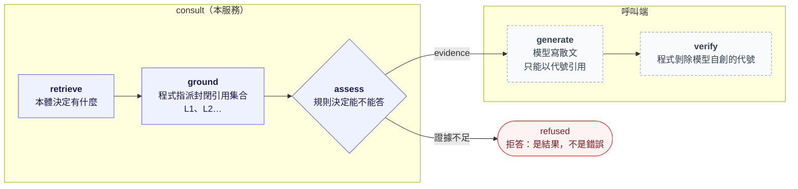

# AGENTS.md

倉庫層規範見根 `AGENTS.md`；本檔只管 `services/consult/`。

## Project

- **Name:** consult（`services/consult`；專案 `EnvCite.Consult`；倉庫為 `envcite`）
- **Role:** 接地服務：以本體服務供給的內容，為**呼叫端的語言模型**備妥可引用的封閉證據集，或拒答。**本服務不執行生成模型**：模型選型、金鑰與計費都不進本服務。**租戶隔離**——`x-tenant-id` 為必填，決定配額與稽核軌跡。
- **Stack:** C# · .NET（SDK 版本在倉庫根 `global.json`）· ASP.NET Core gRPC（Grpc.AspNetCore，非同步，一元呼叫）· Grpc.Net.ClientFactory · xUnit v3（Microsoft.Testing.Platform）
- **共用：** 設定繫結、內部 gRPC 用戶端與遙測在 [`libs/dotnet`](../../libs/dotnet/README.md)，與 platform 同一份，不在本服務另寫。

## 管線形狀（本服務存在的理由）



**模型只決定一件事：如何把手上的證據寫成散文。** 其餘每個決定都在它跑之前由本服務做完，或在它回來之後由呼叫端核驗。形狀的不變式：

- `assess` 可以終止管線：拒答是正常結果，不拋錯誤（呼叫端怎麼處理見倉庫根 `proto/README.md`）。
- 代號由程式指派，永不由模型指派。`L3` 要嘛在清單裡，要嘛不在——這是引用可核驗的全部理由。
- 呼叫端的接法（引用方式、核驗）寫在倉庫根 `proto/README.md`，不寫在這裡。

## Commands

從**本目錄**執行。

```bash
dotnet restore                 # 改了倉庫根 Directory.Packages.props 或 csproj 之後加 --force-evaluate 並提交 packages.lock.json（CI 用 --locked-mode）
dotnet build                   # 警告視為錯誤，等同 lint 與型別檢查
dotnet format                  # --verify-no-changes 只檢查
dotnet test
ENVCITE_Ontology__Address=http://localhost:<ontology 埠> dotnet run --project src/EnvCite.Consult -- --urls http://localhost:<埠>   # worktree 內用 `wt consult`
```

映像以倉庫根為建置情境、離線取套件，指令見 `Dockerfile` 開頭。測試不需要外部服務：本體以行程內的 gRPC fake（`tests/…/FakeOntologyServer.cs`）取代。

## Conventions

- 埠 `IOntologySearch` 是介面，不是用戶端；實作 `OntologySearch` 以 typed gRPC client 呼叫本體。gRPC 產生碼由 Grpc.Tools 在建置時自倉庫根 `proto/` 產生（consult 與 ontology 都產生兩端：測試以 consult 的用戶端打本服務、以 ontology 的伺服器端做假的本體）。
- 門檻（`Grounding` 的 `*Floor`）是**模型條件化的常數**，不是領域常數：只在產生它的計分方式之下可比，該方式一改就必須重新量測分數分佈後重訂。
- 新增管線階段時，同時決定它「在模型之前或之後」——這個問題沒有第三個答案。在模型之前的屬本服務；在模型之後的屬呼叫端，本服務只能在契約與 `proto/README.md` 裡規定它。
- 本體的狀態碼與 trailer 原樣轉出：`ConsultationGrpcService` 不攔本體的 `RpcException`，伺服器以它的狀態回給呼叫端。不要吞成 `UNKNOWN`：呼叫端靠狀態碼分辨參數錯誤與可重試的不可用，靠 trailer 的 `google.rpc.Status` 取 `reason`。
- 期限：呼叫端的期限與取消經用戶端工廠的 `EnableCallContextPropagation` 帶到本體，與 `Ontology:Timeout` 取小者；不在程式裡手算剩餘時間。
- 並行：伺服器是非同步的，等本體時不佔執行緒，所以不設並行上限；容量由本體自己的上限把關，它回的 `RESOURCE_EXHAUSTED` 原樣轉出。
- RED 指標：伺服器端由 `GrpcServerMetrics` 量，只掛在 `ConsultationService` 上，健康檢查的探針不量；約定與 platform 的用戶端同一套（`libs/dotnet` 的 `RpcMetrics`）。
- 優雅關閉：`Draining` 在主機停止 Kestrel 之前先回報 `NOT_SERVING` 並等待；時間以注入的 `TimeProvider` 計，測試用假時鐘。
- 設定只經 `ISectionOptions` 繫結並在啟動時驗證；程式不直接讀 `IConfiguration` 或環境變數。

## Safety

- 設定一律由環境變數或 `appsettings.json` 供給，不提交機密。
- 產生物不手改：`obj/` 下的 gRPC 程式碼（來自倉庫根 proto）；`packages.lock.json` 只經 `dotnet restore` 改。

## Done when

- `dotnet build`（警告即錯誤）、`dotnet format --verify-no-changes`、`dotnet test` 通過。
