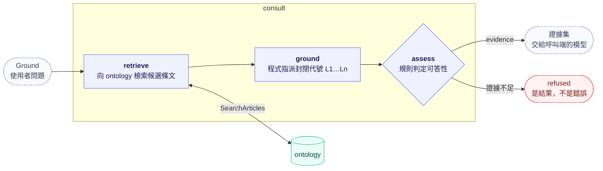

# envcite-consult

接地服務：以本體服務供給的內容，為呼叫端的語言模型備妥可引用的封閉證據集（代號如 `L1`、`L2`，附條文），或拒答。本服務不執行生成模型。回[倉庫總覽](../../README.md)。

| 項目 | 內容 |
|------|------|
| 介面 | gRPC：`ConsultationService.Ground` |
| 技術棧 | Python · uv · gRPC（同步伺服器）；Python 版本見根 `.python-version` |
| 呼叫端 | [`services/platform`](../platform/README.md)（對外為 `POST /v2/ground`） |
| 上游 | [`services/ontology`](../ontology/README.md)（本體內容的唯一來源） |
| 資料 | 租戶隔離，`x-tenant-id` 必填；本服務自己不存資料 |
| 契約 | [`proto/envcite/consult/v2/consult.proto`](../../proto/envcite/consult/v2/consult.proto)；約定見 [`proto/README.md`](../../proto/README.md) |
| 開發指引 | [本目錄 `AGENTS.md`](AGENTS.md)；倉庫層規範見根 [`AGENTS.md`](../../AGENTS.md) |
| 部署 | [`envcite-deploy`](https://gitlab.com/thuaisse-lab/envcite-deploy)（`base/consult/`） |

呼叫端怎麼用證據集、怎麼核驗模型的輸出，見 [`proto/README.md`](../../proto/README.md)。

## 管線



模型只決定一件事：把手上的證據寫成散文。哪些條文可以引用、能不能答，都在它跑之前由本服務決定；寫完之後的核驗是呼叫端的責任。

## 先決條件

| 項目 | 說明 |
|------|------|
| [uv](https://docs.astral.sh/uv/) | Python 版本由 uv 安裝 |
| [ontology](../ontology/README.md) | 本服務唯一的上游；位址放 `ONTOLOGY_TARGET`。測試不需要它（以 fake 代替） |

```bash
uv sync --all-packages        # 整個 workspace（.venv 與 uv.lock 在倉庫根）
```

## 入口

| 入口 | 型態 | 做什麼 |
|------|------|--------|
| `envcite-consult` | 長駐 | gRPC 伺服器 |

**環境變數**：名稱、必填與預設值以 [`src/envcite_consult/server.py`](src/envcite_consult/server.py) 為準；至少要給 `ONTOLOGY_TARGET`（ontology 的 gRPC 目標）。

### 在本機跑起來

```bash
ONTOLOGY_TARGET=dns:///localhost:<ontology 埠> uv run envcite-consult
```

平行 worktree 用 `wt consult`，會指向本樹的 ontology，見 [`CONTRIBUTING.md`](../../CONTRIBUTING.md)。呼叫端怎麼用本服務的輸出見 [`proto/README.md`](../../proto/README.md)；實作約束見 [`AGENTS.md`](AGENTS.md)。

## 開發

```bash
uv run python -m pytest        # 本體以 fake 實作，不需要外部服務
uv run ruff check .            # lint；ruff format . 格式化
uv run python -m mypy src tests
../../libs/python/envcite-proto/scripts/generate.sh   # 改了 proto 之後重新產生程式碼
docker build -f Dockerfile ../..                      # 映像；建置內容為倉庫根
```

- 工具設定在根 `pyproject.toml`；CI 的檢查項目見 `.gitlab-ci.yml`。
