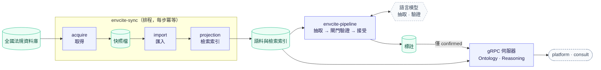

# envcite-ontology

法規本體（`law`）的語料、檢索與推論服務；資料為臺灣環境法規。回[倉庫總覽](../../README.md)。

| 項目 | 內容 |
|------|------|
| 介面 | gRPC：`OntologyService`（法規與檢索）、`ReasoningService`（標註與推論） |
| 技術棧 | Python · uv · gRPC · PostgreSQL；Python 版本見根 `.python-version` |
| 呼叫端 | `services/platform`、`services/consult` |
| 資料 | 全域共用，不分租戶；PostgreSQL 為唯一真值 |
| 契約 | `proto/envcite/ontology/v1/ontology.proto`、`reasoning.proto` |
| 資料來源 | 全國法規資料庫（政府資料開放授權條款－第1版，須標示出處） |
| 開發指引 | 本目錄 `AGENTS.md`；倉庫規範見根 `AGENTS.md` |

## 資料流



- **語料與檢索**：`envcite-sync` 依序取得、匯入、投影檢索索引。
- **標註**：`envcite-pipeline` 是語言模型的唯一使用處；推論（clingo）不用模型。
- **推論**：只取已確認的標註；結論都是候選，不替呼叫端做最後認定。

## 先決條件

| 項目 | 說明 |
|------|------|
| [uv](https://docs.astral.sh/uv/) | Python 版本見根 `.python-version`，由 uv 安裝 |
| PostgreSQL | 版本與建法見根 `CONTRIBUTING.md`；連線字串放 `ONTOLOGY_DSN` |
| Docker | 測試的 Testcontainers 用；已有資料庫則設 `ONTOLOGY_TEST_DSN` |

```bash
uv sync --all-packages        # 整個 workspace；標註管線用 Anthropic 模型時加 --extra llm
```

## 入口

所有入口都在同一個映像裡：預設 command 是伺服器，其餘以 command 覆寫，與服務用同一份程式碼與設定。完整清單見 `pyproject.toml` 的 `[project.scripts]`。

| 入口 | 型態 | 做什麼 |
|------|------|--------|
| `envcite-ontology` | 長駐 | gRPC 伺服器 |
| `envcite-migrate` | 一次性 | 套用 `migrations/*.sql`；已套用的檔案不可修改，要改就新增一個 |
| `envcite-sync <來源>` | 排程 | 取得、匯入、檢索投影，三步冪等 |
| `envcite-acquire <來源>` | 一次性 | 只取得快照 |
| `envcite-import <來源>` | 一次性 | 快照寫入語料；`--dry-run` 只解析與驗收 |
| `envcite-pipeline` | 排程 | 標註：抽取、驗證、接受（見下節） |
| `envcite-annotate <檔>` | 一次性 | 載入一份人寫的標註 JSON |
| `envcite-verify` | 一次性 | 只跑確定性閘門的驗證；`--require <方法,…>` |

`<來源>` 登記在 `src/envcite_ontology/acquire/cli.py` 的 `SOURCES`；`moj` 是全國法規資料庫。

**環境變數**

| 變數 | 用於 |
|------|------|
| `ONTOLOGY_DSN` | 所有入口 |
| `ONTOLOGY_GRPC_PORT` | `envcite-ontology`（選用） |
| `ACQUIRE_SNAPSHOT_DIR` | `envcite-sync`、`envcite-acquire`、`envcite-import` |
| `CHAT_API_KEY` | `envcite-pipeline`，由 `models.toml` 引用 |

名稱、必填與預設值以 `src/envcite_ontology/settings.py` 為準。

`envcite-sync`、`acquire`、`import` 的結束碼：`0` 成功或無事可做，`1` 暫時性失敗（可重試），`2` 資料不合預期（重試無益）。

### 在本機跑起來

本機用 `uv run --env-file .env <入口>` 執行同一個入口；環境裡已有的同名變數優先於 `.env`。

```bash
cp .env.example .env                       # 資料庫連線、快照目錄；依需要修改
uv run --env-file .env envcite-migrate
uv run --env-file .env envcite-sync moj
uv run --env-file .env envcite-ontology    # 重建索引後要重啟服務
```

## 標註管線

`envcite-pipeline` 讀現行條文，由語言模型抽取成結構化陳述，再經閘門驗證，通過才升為 `confirmed`。

```bash
uv run --env-file .env envcite-pipeline --law <pcode> --models models.toml          # 指定法規
uv run --env-file .env envcite-pipeline --pending --limit <N> --models models.toml   # 自找待辦，最多 N 部
```

- `--pending` 找「現行文字還沒被此抽取者與版本答過」的法規；答過的單元會留紀錄，重跑會收斂。`--limit` 是每次的模型費用上限。
- 同一時間只跑一個（PostgreSQL 諮詢鎖）；每個陳述驗完就 commit，中斷不丟進度。
- 抽取者不得驗證自己；沒有人審核標註，只有通過閘門的才進推論。

### 模型配置（`models.toml`）

模型與角色全部寫在一個 TOML 檔，由 `--models` 指定，沒有別的設定途徑。範本是 `models.example.toml`；`models.toml` 不進版控。

從倉庫根開始：

```bash
cd services/ontology
cp models.example.toml models.toml   # 改端點網址與要用的模型
cp .env.example .env                 # 用編輯器填入 CHAT_API_KEY，不要貼到對話或提交
uv run --env-file .env envcite-pipeline --models models.toml --check   # 確認端點、金鑰與每個模型都通
```

`--check` 對每個模型送固定的探測問題，不連資料庫；通過後才用 `--law` 或 `--pending` 開跑。

```toml
[endpoint.<名>]   # OpenAI 相容的服務：網址與金鑰的位置
[model.<別名>]    # 用哪個端點、送出什麼名稱、屬於哪個家族
[roles]           # 四個角色各指名模型別名
```

缺角色、不認得的鍵、參照不存在的名稱，載入時一律報錯。

**端點**

| 鍵 | 說明 |
|----|------|
| `base_url` / `base_url_env` | 服務網址（含 `/v1`）/ 存放網址的環境變數名稱；恰好給一個 |
| `api_key_env` / `api_key_file` | 存放金鑰的環境變數名稱 / 金鑰檔路徑（相對於 `models.toml`）；至多一個，都不給表示不需金鑰 |

**模型**

| 鍵 | 說明 |
|----|------|
| `name` | 必填。原樣送給端點的模型識別 |
| `endpoint`、`family` | `provider = "chat"`（預設）時必填；`family` 由人宣告 |
| `provider` | `chat` 或 `anthropic`；`anthropic` 不寫 `endpoint`、`family`，金鑰取自 `ANTHROPIC_API_KEY`，需 `--extra llm` |
| `max_tokens` | 回答長度上限；推理模型的思考計入輸出長度，要留足 |
| `max_retries` | 暫時性失敗的重試次數；`0` 不重試 |

**角色與獨立性**

| 角色 | 做什麼 |
|------|--------|
| `extractor` | 讀條文，寫出結構化陳述 |
| `roundtrip` | 沒看過原文，只依陳述的確定性描述重抽，比對結構 |
| `independent_test` | 只讀原文設計案例，丟進推論程式比對 |
| `panel`（別名清單） | 評審團，多數決 |

- 驗證者與抽取者同一家族時，該閘門不採計，結果停在 `inconclusive`。
- 家族不從名字推測：託管服務上的模型名稱可能是別名，同一個模型掛在幾個名字下。開跑前管線對所有模型送固定的探測問題，答案逐字相同就拒絕開跑。

### 金鑰

金鑰只放 `.env` 的 `CHAT_API_KEY`（`.env` 不進版控）；`models.toml` 的端點以 `api_key_env = "CHAT_API_KEY"` 引用，管線只讀這個環境變數。不要把金鑰寫進 `models.toml`、貼進對話或提交。

## 開發

```bash
uv run python -m pytest        # 測試用真實 PostgreSQL，不用替身
uv run ruff check .            # lint；ruff format . 格式化
uv run python -m mypy src tests
../../libs/python/envcite-proto/scripts/generate.sh   # 改了 proto 之後重新產生程式碼
docker build -f Dockerfile ../..                      # 映像；建置內容為倉庫根
```

- 工具設定在根 `pyproject.toml`；CI 的檢查項目見 `.gitlab-ci.yml`。
- 可觀測性：設了 `OTEL_EXPORTER_OTLP_ENDPOINT` 才匯出追蹤與指標，沒設就什麼都不做。
