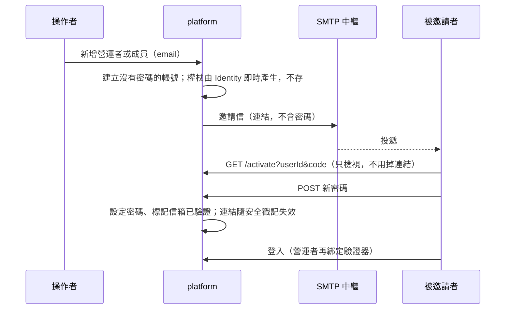

<!--
type: reference
applies-to: all
owns: [operator-accounts, mail-invitation, reasoning-rest, corpus-scope]
-->

# envcite-platform

多租戶控制平面：租戶、API key、限流、計量，以及對外 REST API（`/v2`）。法規與接地請求經 gRPC 轉給 `services/ontology` 與 `services/consult`。回[倉庫總覽](../../README.md)。

- 介面：`/v2` 租戶 REST API（API key）；`/ui` 營運者後台；`/portal` 客戶入口（以設定開關）。契約 [`openapi/openapi_v2.json`](openapi/openapi_v2.json)（`dotnet build` 產生、隨程式碼提交）；上游 gRPC 契約與外部呼叫端的接法見 [`proto/README.md`](../../proto/README.md)。
- 外部用戶端只經本服務進入系統；上游 [`ontology`](../ontology/README.md)、[`consult`](../consult/README.md)（gRPC，啟動時必須設定位址）。
- 資料：PostgreSQL，schema `platform`；租戶隔離是執行期機制（租戶解析加查詢過濾）。

## 概念

| 層 | 節 | 這裡有 |
|----|----|--------|
| 範圍 | [語料範圍](#語料範圍) | 只涵蓋中央法規 |
| 請求 | [一次 `/v2` 請求](#一次-v2-請求) | 驗證、方案、限流、計量，以及失敗時的狀態碼 |
| 請求 | [推論](#推論post-v2reasoningevaluate) | `POST /v2/reasoning/evaluate` 的欄位 |
| 入口 | [入口](#入口) | 主機，以及設定鍵的真值在哪 |
| 帳號 | [營運者帳號](#營運者帳號) | 欄位、端點、首次登入規則 |

## 語料範圍

`/v2` 的法規、搜尋、接地與推論只涵蓋**中央法規**；**地方自治法規（自治條例、自治規則等）不在範圍內**。這是產品範圍，不是語料的缺口：

- **問句明白在問自治法規時，拒答原因就是範圍**：`POST /v2/ground` 的問句出現「自治條例」「自治法規」「自治規則」「地方加嚴」之一（詞表真值在 consult 的 `LocalMarker.cs`），而且沒有達標的條文時，`refusal.reason` 為 `local_law_uncovered`。呼叫端要對使用者說明語料只涵蓋中央法規，請使用者另查該地方政府的法規。有達標的條文時照常回證據（中央條文可能正是答案），呼叫端不可把這份證據當成地方法規的答案。
- **其餘情形範圍外與「查無」無法從回應區分**：問句沒有上述字樣（例如只點名縣市）時，`POST /v2/search` 沒有結果、`POST /v2/ground` 的 `no_authority`／`out_of_scope`、`GET /v2/laws/…` 的 404，都不代表地方法規沒有規定。呼叫端對使用者呈現時不得暗示「地方沒有相關規定」。
- **識別碼的格式不代表語料範圍**：`jurisdiction`、`idScheme` 的合法值含縣市管轄與地方方案（取值見 [`ontology.proto`](../../proto/envcite/ontology/v2/ontology.proto) 的 `LawIdentifier`），那是契約預留；帶縣市管轄的識別碼與任何不在語料的識別碼一樣查無。
- **`refusal.reason` 的 `out_of_scope` 不是語料範圍外**：它指檢索到的條文都未達相關度門檻（問的是別的事）；拒答的語意見 [`proto/README.md`](../../proto/README.md) 的〈呼叫端的語言模型〉。

對外規格 [`openapi/openapi_v2.json`](openapi/openapi_v2.json) 的 `info.description` 帶同一句範圍聲明（來源 `PlatformOpenApi.cs`）。

## 一次 `/v2` 請求

管理端點（自己是誰、用量、API key）不經方案檢查；細節見 [`AGENTS.md`](AGENTS.md) 的 Plans & access。

## 推論（`POST /v2/reasoning/evaluate`）

案件事實放請求本文，回應是 `atDecision`（裁處時之法律）與 `earlier`（其間不同的法律組）。欄位與型別以 [`openapi/openapi_v2.json`](openapi/openapi_v2.json) 為準；推論語意（何時附條件、何時不列出）見 [`proto/README.md`](../../proto/README.md) 的「標註與推論」。REST 與 gRPC 的對映規則：

- 欄位名是 gRPC 欄位的 camelCase，列舉是去掉前綴的 PascalCase 名稱（`DELEGATION_GAP_NO_CITATION` → `NoCitation`），不是數字。
- 請求裡省略的是「未知」：`administrativePenalty` 的是／否、金額與日期欄位省略即不送出，不當作否或 0。金額、時數、工資與所得利益是十進位文字。
- 回應裡沒有的是 `null`，不是空字串或 0：額度缺（`minAmount`、`maxAmount`）、授權環節的引文與對到的法規（`citedLawName`、`citedPath`、`identifier`、`uri`）。清單永遠存在，沒有就是空的。
- 授權環節的 `gap` 為 `null` 表示這一環成立（gRPC 的零值）。

| REST 欄位 | 依據 |
|-----------|------|
| `invalidated[]`：`statementId`、`uri`、`rulingNo`、`invalidFrom`、`partial` | 違憲失效而不參與推論的陳述；`verdicts` 少了某則先看這裡 |
| `delegationBases[]`：`statementId`、`rooted`、`links[]`（`commandIdentifier`、`citedLawName`、`citedPath`、`identifier`、`uri`、`gap`；兩個 identifier 是 `{jurisdiction, idScheme, localId}` 物件） | 命令陳述往上到法律的授權鏈；`rooted` 為假時相關罰則附條件 |
| `general.reduced[]`：`penaltyStatementId`、`mitigation`、`share`（`Half`／`Third`）、`minAmount`、`maxAmount` | 行政罰法第 18 條第 3 項減輕後的範圍 |
| `general.raisedCaps[]`：`penaltyStatementId`、`maxAmount` | 第 18 條第 2 項依所得利益加重的上限 |
| `general.criminalDeductions[]`：`penaltyStatementId`、`amount` | 第 26 條第 3、4 項的扣抵額 |
| `general.unpunished[].excuse` 的 `CriminalPriority` | 第 26 條第 1 項刑事優先，罰鍰不列出 |
| `problems[].kind` 的 `InvalidatedDelegation`（`conditionId`） | 授權的限值所在條文已違憲失效，要件為未知 |
| 請求 `administrativePenalty`：`criminalOffense`、`courtConfiscated`、`criminalClearedOn`、`criminalPayment`、`communityServiceHours`、`minimumHourlyWage`、`gainedBenefit` | 第 18、26 條所依的事實 |

## 入口

`src/EnvCite.Platform.Api`（長駐）：ASP.NET Core 主機，REST、後台與入口頁；Development 啟動時自動遷移。設定的鍵名、必填與預設值以各設定群組的選項類別與 `appsettings.json` 為準，規則見 [`AGENTS.md`](AGENTS.md) 的 Configuration。開發指令見 [`AGENTS.md`](AGENTS.md)。

## 營運者帳號

營運者後台（`/ui`）的帳號不開放自助註冊；除本機 Development 的種子帳號外，第一位營運者以命令列建立，之後的營運者在後台 `/ui/operators` 新增、停用、重設。本機順序見 [`CONTRIBUTING.md`「本機第一個帳號」](../../CONTRIBUTING.md#本機第一個帳號)。staging 的步驟見 [`索引`](../../CONTRIBUTING.md#索引)。

**命令列**：在服務自己的環境裡執行（資料庫連線與設定取自該環境），不啟動 HTTP 伺服器，跑完就結束。一次性初始密碼只印在標準輸出，不進日誌或稽核；稽核的操作者記為 `system`。以服務的進入點執行，例如 `dotnet EnvCite.Platform.Api.dll operator create a@example.com`。

| 指令 | 用途 |
|------|------|
| `operator create <email> [顯示名稱]` | 建立營運者。已啟用寄信時寄邀請信（不產生密碼，也不印連結）；否則印出一次性初始密碼 |
| `operator resend-invite <email>` | 重寄邀請信（先前的連結失效）；已有密碼但信箱未驗證的則寄驗證信 |
| `operator reset-password <email>` | 重設密碼，印出新的一次性密碼（寄信失敗或收不到信時的退路） |
| `operator reset-two-factor <email>` | 清除驗證器；對方下次登入重新綁定 |
| `mail test <email>` | 用目前的 `Platform:Mail` 設定寄一封測試信，確認中繼接受；見[寄信](#寄信platformmail) |

結束碼：`0` 成功、`1` 操作失敗（帳號已存在、找不到營運者、帳號已建立但邀請信沒寄出，或測試信沒寄成）、`2` 用法錯誤。

**前提**：`/ui` 已開啟。

**規則**：以 email 登入（`/ui/login`）。經[邀請](#邀請與信箱驗證)建立的，密碼是自己設的，登入後直接綁定 TOTP 驗證器；用暫時密碼建立的，首次登入先改密碼再綁定。兩條路的順序都是「先有只有本人知道的密碼，再綁定驗證器」，TOTP 對每位營運者強制。

**後台**：`/ui/operators` 列出營運者與狀態（含「待啟用」、「信箱未驗證」），可新增（啟用寄信時是邀請）、重寄邀請或驗證信、重設密碼、重設驗證器、停用與啟用；停用在下一個請求生效。營運者不能對自己的那一列操作。

不變式（授權、順序為何固定）見 [`AGENTS.md`](AGENTS.md) 的「營運者帳號」。

## 邀請與信箱驗證

登入名稱是 email（不分大小寫；營運者全域唯一，入口成員在租戶內唯一）。`EmailConfirmed` 表示信箱歸屬已由連結證明。

兩條建立帳號的路，由 `Platform:Mail:Enabled` 決定：

| | 啟用寄信（邀請） | 沒啟用寄信（暫時密碼） |
|---|---|---|
| 建立後的帳號 | 沒有密碼，信箱未驗證 | 有一次性初始密碼，信箱未驗證 |
| 交給對方的 | 一封信，內有單次、限時的連結；**信裡沒有密碼** | 操作者親手交付的一次性密碼 |
| 對方第一次要做 | 開啟連結，設定自己的密碼；信箱同時驗證 | 用該密碼登入，立刻改掉 |
| 營運者之後 | 登入，綁定 TOTP 驗證器 | 改密碼，再綁定 TOTP 驗證器 |
| 信箱驗證 | 開啟連結即完成 | 另寄驗證信（開啟連結只確認信箱） |

連結的網址為 `<BaseUrl>/ui/activate?userId=<帳號 Id>&code=<權杖>`（營運者）或 `<BaseUrl>/portal/<租戶>/activate?userId=…&code=…`（成員）。規則：

- 只是開啟網頁不會用掉連結（信件掃描器會預先開啟），送出表單才會；設好密碼後連結立即失效。
- 連結無效、過期、已用過、租戶不符、帳號被停用或不存在，一律是同一個結果（`activation.link_invalid`），不透露帳號是否存在。
- 密碼不符規則時連結仍有效，可以重打。啟用不簽發 session：使用者接著照常登入。
- 操作者可在清單上對「待啟用」或「信箱未驗證」的帳號重寄：還沒有密碼的重發邀請，先前的連結隨之失效；已有密碼的寄驗證連結，開啟後只確認信箱。重設密碼（暫時密碼）是任何時候都能用的退路，寄信失敗或收不到信時用它。
- 登入不要求信箱已驗證。信箱驗證前不得作為復原管道。

## 寄信（`Platform:Mail`）

可選功能，預設關閉。環境變數寫成 `ENVCITE_Platform__Mail__<鍵>`；開啟時缺漏或錯值在啟動就停下並指名鍵。

| 鍵 | 開啟時必填 | 說明 |
|----|-----------|------|
| `Enabled` | | 開關；沒開時建立帳號走暫時密碼 |
| `Host`、`Port` | `Host` | SMTP 中繼的主機與埠 |
| `From`、`FromName` | `From` | 寄件者；中繼通常只收自己網域的寄件者 |
| `BaseUrl` | 是 | 信裡連結的來源：`https://主機`，不含路徑（只有 localhost 可用 `http`）。寫死在設定，不取自請求的 Host 標頭 |
| `LinkLifetime` | | 連結的有效期限（1 小時至 14 天），也是 Identity 資料保護權杖的期限 |
| `TimeoutSeconds` | | 連線到回應的總時限；逾時算寄信失敗 |

連線是**不加密、免驗證**的 SMTP（沒有 TLS 與帳密鍵），只用於來源位址被信任的內網中繼；因此信裡只有連結，沒有密碼，連結短效、單次。寄信用 MailKit。

寄出的結果是 `Sent`（中繼接受了信，不等於已投遞）、`Failed`、`Disabled`（未啟用）或 `NotRequested`（沒有收件地址）。寄不出去不使建立或重寄失敗，帳號照樣在，畫面與命令列照實顯示。稽核只記結果（`mail`），不記連結；日誌只記例外型別與 SMTP 狀態碼，不含位址與內文。

**測試**：在服務自己的環境裡執行 `mail test <email>`（見上表）。它印出實際使用的中繼、寄件者與連結來源，寄一封沒有連結、沒有密碼的測試信，並以結束碼說明結果。來源位址是否被中繼信任只能在服務實際執行的環境驗證，從別的機器測通不代表服務能寄。

| 現象 | 常見原因 |
|------|----------|
| `寄信未啟用` | `Enabled` 不是 `true` |
| `Failed`，日誌是 `SocketException`、`IOException` 或逾時 | 連不上 `Host:Port`：DNS、防火牆、埠錯誤 |
| `Failed`，日誌帶 `550`、`554` 之類的 SMTP 狀態碼 | 來源位址不在中繼的信任名單，或 `From`、收件者的網域被中繼拒絕 |
| `Failed`，日誌是 `FormatException` | 收件地址格式不合法 |
| `Sent`，但沒收到 | 中繼接受了信但沒投遞：查垃圾信匣與中繼的郵件追蹤 |

本機與正式環境的操作順序見 [`CONTRIBUTING.md`「本機收信與寄信測試」](../../CONTRIBUTING.md#本機收信與寄信測試)。
