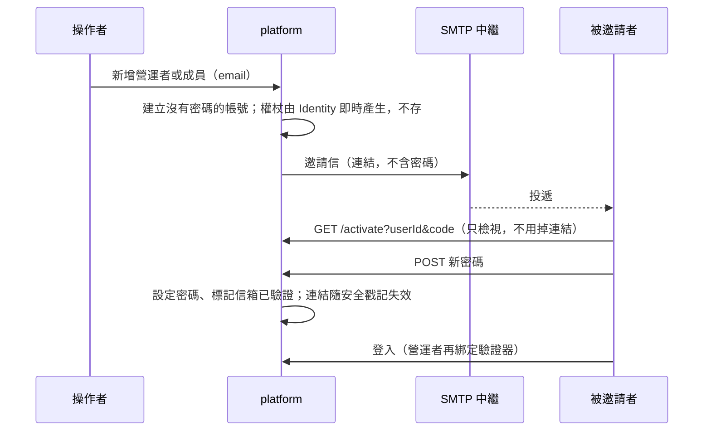

<!--
type: reference
applies-to: all
owns: [operator-accounts, mail-invitation, reasoning-rest, corpus-scope, brand-name, service-logging, tenant-access-urls, appearance-setting, tenant-directory-sync]
-->

# envcite-platform

多租戶控制平面：租戶、API key、限流、計量，以及對外 REST API（`/v2`）。法規與接地請求經 gRPC 轉給 `services/ontology` 與 `services/consult`。回[倉庫總覽](../../README.md)。

- 介面：`/v2` 租戶 REST API（API key）；`/ui` 營運者後台；`/portal` 客戶入口（以設定開關）。契約 [`openapi/openapi_v2.json`](openapi/openapi_v2.json)（`dotnet build` 產生、隨程式碼提交）；上游 gRPC 契約與外部呼叫端的接法見 [`proto/README.md`](../../proto/README.md)。
- 外部用戶端只經本服務進入系統；上游 [`ontology`](../ontology/README.md)、[`consult`](../consult/README.md)（gRPC，啟動時必須設定位址）。
- 資料：PostgreSQL，schema `platform`；租戶隔離是執行期機制（租戶解析加查詢過濾）。

## 概念

| 層 | 節 | 這裡有 |
|----|----|--------|
| 範圍 | [語料範圍](#語料範圍) | 只涵蓋中央法規 |
| 請求 | [一次 `/v2` 請求](#一次-v2-請求) | 驗證、方案、限流、計量，以及失敗時的狀態碼 |
| 請求 | [推論](#推論post-v2reasoningevaluate) | `POST /v2/reasoning/evaluate` 的欄位 |
| 入口 | [入口](#入口) | 主機，以及設定鍵的真值在哪 |
| 帳號 | [營運者帳號](#營運者帳號) | 欄位、端點、首次登入規則 |
| 品牌 | [系統名稱](#系統名稱platformbrand) | 名稱的唯一來源、哪些地方跟著變、改名時要另外換的 |
| 帳號 | [目錄同步](#目錄同步platformdirectory) | 客戶的身分來源把成員推進租戶：設定鍵、規則、受管成員、SCIM 端點 |

## 語料範圍

`/v2` 的法規、搜尋、接地與推論只涵蓋**中央法規**；**地方自治法規（自治條例、自治規則等）不在範圍內**。這是產品範圍，不是語料的缺口：

- **問句明白在問自治法規時，拒答原因就是範圍**：`POST /v2/ground` 的問句出現「自治條例」「自治法規」「自治規則」「地方加嚴」之一（詞表真值在 consult 的 `LocalMarker.cs`），而且沒有達標的條文時，`refusal.reason` 為 `local_law_uncovered`。呼叫端要對使用者說明語料只涵蓋中央法規，請使用者另查該地方政府的法規。有達標的條文時照常回證據（中央條文可能正是答案），呼叫端不可把這份證據當成地方法規的答案。
- **其餘情形範圍外與「查無」無法從回應區分**：問句沒有上述字樣（例如只點名縣市）時，`POST /v2/search` 沒有結果、`POST /v2/ground` 的 `no_authority`／`out_of_scope`、`GET /v2/laws/…` 的 404，都不代表地方法規沒有規定。呼叫端對使用者呈現時不得暗示「地方沒有相關規定」。
- **識別碼的格式不代表語料範圍**：`jurisdiction`、`idScheme` 的合法值含縣市管轄與地方方案（取值見 [`ontology.proto`](../../proto/envcite/ontology/v2/ontology.proto) 的 `LawIdentifier`），那是契約預留；帶縣市管轄的識別碼與任何不在語料的識別碼一樣查無。
- **`refusal.reason` 的 `out_of_scope` 不是語料範圍外**：它指檢索到的條文都未達相關度門檻（問的是別的事）；拒答的語意見 [`proto/README.md`](../../proto/README.md) 的〈呼叫端的語言模型〉。

對外規格 [`openapi/openapi_v2.json`](openapi/openapi_v2.json) 的 `info.description` 帶同一句範圍聲明（來源 `PlatformOpenApi.cs`）。

## 一次 `/v2` 請求


管理端點（自己是誰、用量、API key）不經方案檢查；細節見 [`AGENTS.md`](AGENTS.md) 的 Plans & access。

## 推論（`POST /v2/reasoning/evaluate`）

案件事實放請求本文，回應是 `atDecision`（裁處時之法律）與 `earlier`（其間不同的法律組）。欄位與型別以 [`openapi/openapi_v2.json`](openapi/openapi_v2.json) 為準；推論語意（何時附條件、何時不列出）見 [`proto/README.md`](../../proto/README.md) 的「標註與推論」。REST 與 gRPC 的對映規則：

- 欄位名是 gRPC 欄位的 camelCase，列舉是去掉前綴的 PascalCase 名稱（`DELEGATION_GAP_NO_CITATION` → `NoCitation`），不是數字。
- 請求裡省略的是「未知」：`administrativePenalty` 的是／否、金額與日期欄位省略即不送出，不當作否或 0。金額、時數、工資與所得利益是十進位文字。
- 回應裡沒有的是 `null`，不是空字串或 0：額度缺（`minAmount`、`maxAmount`）、授權環節的引文與對到的法規（`citedLawName`、`citedPath`、`identifier`、`uri`）。清單永遠存在，沒有就是空的。
- 授權環節的 `gap` 為 `null` 表示這一環成立（gRPC 的零值）。

| REST 欄位 | 依據 |
|-----------|------|
| `invalidated[]`：`statementId`、`uri`、`rulingNo`、`invalidFrom`、`partial` | 違憲失效而不參與推論的陳述；`verdicts` 少了某則先看這裡 |
| `delegationBases[]`：`statementId`、`rooted`、`links[]`（`commandIdentifier`、`citedLawName`、`citedPath`、`identifier`、`uri`、`gap`；兩個 identifier 是 `{jurisdiction, idScheme, localId}` 物件） | 命令陳述往上到法律的授權鏈；`rooted` 為假時相關罰則附條件 |
| `general.reduced[]`：`penaltyStatementId`、`mitigation`、`share`（`Half`／`Third`）、`minAmount`、`maxAmount` | 行政罰法第 18 條第 3 項減輕後的範圍 |
| `general.raisedCaps[]`：`penaltyStatementId`、`maxAmount` | 第 18 條第 2 項依所得利益加重的上限 |
| `general.criminalDeductions[]`：`penaltyStatementId`、`amount` | 第 26 條第 3、4 項的扣抵額 |
| `general.unpunished[].excuse` 的 `CriminalPriority` | 第 26 條第 1 項刑事優先，罰鍰不列出 |
| `problems[].kind` 的 `InvalidatedDelegation`（`conditionId`） | 授權的限值所在條文已違憲失效，要件為未知 |
| 請求 `administrativePenalty`：`criminalOffense`、`courtConfiscated`、`criminalClearedOn`、`criminalPayment`、`communityServiceHours`、`minimumHourlyWage`、`gainedBenefit` | 第 18、26 條所依的事實 |

## 入口

`src/EnvCite.Platform.Api`（長駐）：ASP.NET Core 主機，REST、後台與入口頁；Development 啟動時自動遷移。設定的鍵名、必填與預設值以各設定群組的選項類別與 `appsettings.json` 為準，規則見 [`AGENTS.md`](AGENTS.md) 的 Configuration。開發指令見 [`AGENTS.md`](AGENTS.md)。

## 租戶頁的存取網址

租戶頁（`/ui/tenants/{租戶}`）頁首下方的「存取網址」，有沒有成員或 API key 都顯示。只列兩顆複製按鈕（複製完整網址，不在畫面上列出）：

| 按鈕 | 複製的網址 |
|------|-----------|
| 複製登入網址 | `https://<主機>/portal/<租戶識別碼>/login`（識別碼經百分比編碼） |
| 複製 API Base URL | `https://<主機>/v2` |

主機取自目前請求的來源（scheme 與主機；Gateway 之後由 forwarded headers 還原），沒有對應的設定鍵：後台、入口與 API 同一個主機。`Platform:Mail:BaseUrl` 只管信裡的連結，不是通用的對外網址。複製元件的用法見 [`AGENTS.md`](AGENTS.md)「設計系統與營運者後台」。

## 個人設定與外觀

登入後的「個人設定」放使用者自己的偏好，目前只有外觀：**系統**（預設，跟隨裝置）、**亮色**、**暗色**。營運者後台與客戶入口各有一頁，共用同一個 `Shared/AppearanceSetting` 元件：

| 面 | 頁面 | 設定外觀的端點 |
|----|------|----------------|
| 營運者後台 | `GET /ui/settings` | `POST /ui/appearance` |
| 客戶入口 | `GET /portal/{租戶}/settings` | `POST /portal/{租戶}/appearance` |

- **預設是「系統」**：沒有偏好時 `<html>` 不帶 `data-theme`，外觀只靠 `prefers-color-scheme`（瀏覽器與作業系統）。
- **偏好是這個瀏覽器的 cookie**（名稱 `ep-appearance`，值 `light` 或 `dark`；名稱、有效期與屬性描述在 `AppearanceOptions.Cookie`），路徑 `/`：營運者後台、客戶入口與登入前的頁面看到同一個偏好。不跨裝置、不分帳號、不進資料庫。選回「系統」是刪掉 cookie；cookie 不存在、被清掉或值不合法一律當作「系統」。
- **端點**：表單欄位 `appearance`（`system`、`light`、`dark`）與 `returnUrl`；需要 antiforgery，不需要登入（偏好不認證任何東西）。值不合法回 400、不寫 cookie。一般表單送出導回 `returnUrl`（只准留在該面之下）；`Accept: application/json` 的請求（個人設定頁的腳本）回 204。
- **匿名頁面**（登入、啟用、重設、已登出、無權限）不提供切換，但一樣依 cookie 輸出偏好。
- 設計規則與理由見 [`AGENTS.md`](AGENTS.md)「設計系統與營運者後台」。

## 日誌

主控台日誌的等級是標準的 `Logging:LogLevel`，真值在 [`appsettings.json`](src/EnvCite.Platform.Api/appsettings.json)。

**EF Core 的 SQL**：每條 SQL 是類別 `Microsoft.EntityFrameworkCore.Database.Command` 的 Information。預設把這個類別調到 Warning，[命令列](#營運者帳號)的結果與 `kubectl logs` 才不被一長串 SQL 蓋掉；失敗的指令（Error）仍會記。只調這一個類別：遷移進度（`Microsoft.EntityFrameworkCore.Migrations`）、連線錯誤等其他 EF 日誌照一般等級。SQL 的參數值 EF 預設遮蔽為 `?`，本服務沒有開 `EnableSensitiveDataLogging`。

要看 SQL 時，用環境變數把該類別調回 Information，不改檔案提交：

```bash
env 'ENVCITE_Logging__LogLevel__Microsoft.EntityFrameworkCore.Database.Command=Information' <啟動指令>
```

類別名稱裡的點照原樣寫。shell 的 `export` 不接受含點的名稱，所以用 `env`；k8s 的環境變數名稱允許點。

## 營運者帳號

營運者後台（`/ui`）的帳號不開放自助註冊；除本機 Development 的種子帳號外，第一位營運者以命令列建立，之後的營運者在後台 `/ui/operators` 新增、停用、重設。本機順序見 [`CONTRIBUTING.md`「本機第一個帳號」](../../CONTRIBUTING.md#本機第一個帳號)。staging 的步驟見 [`索引`](../../CONTRIBUTING.md#索引)。

**命令列**：在服務自己的環境裡執行（資料庫連線與設定取自該環境），不啟動 HTTP 伺服器，跑完就結束。一次性初始密碼只印在標準輸出，不進日誌或稽核；稽核的操作者記為 `system`。主控台除了命令自己的訊息，只剩 Warning 以上的日誌（SQL 預設不印，見[日誌](#日誌)）。以服務的進入點執行，例如 `dotnet EnvCite.Platform.Api.dll operator create a@example.com`。

| 指令 | 用途 |
|------|------|
| `operator create <email> [顯示名稱]` | 建立營運者。已啟用寄信時寄邀請信（不產生密碼，也不印連結）；否則印出一次性初始密碼 |
| `operator resend-invite <email>` | 重寄邀請信（先前的連結失效）；已有密碼但信箱未驗證的則寄驗證信 |
| `operator reset-password <email>` | 重設密碼，印出新的一次性密碼（寄信失敗或收不到信時的退路） |
| `operator reset-two-factor <email>` | 清除驗證器；對方下次登入重新綁定 |
| `mail test <email>` | 用目前的 `Platform:Mail` 設定寄一封測試信，確認中繼接受；見[寄信](#寄信platformmail) |
| `mail preview <輸出目錄>` | 把信件版型（邀請、驗證、測試信）寫成 `.html` 與 `.txt` 檔，連結是占位值；**不寄信、不連資料庫**，不需要啟用 `Platform:Mail`；見[寄信](#寄信platformmail) |

結束碼：`0` 成功、`1` 操作失敗（帳號已存在、找不到營運者、帳號已建立但邀請信沒寄出，或測試信沒寄成）、`2` 用法錯誤。

**前提**：`/ui` 已開啟。

**規則**：以 email 登入（`/ui/login`）。經[邀請](#邀請與信箱驗證)建立的，密碼是自己設的，登入後直接綁定 TOTP 驗證器；用暫時密碼建立的，首次登入先改密碼再綁定。兩條路的順序都是「先有只有本人知道的密碼，再綁定驗證器」，TOTP 對每位營運者強制。

**後台**：`/ui/operators` 列出營運者與狀態（含「待啟用」、「信箱未驗證」），可新增（啟用寄信時是邀請）、重寄邀請或驗證信、重設密碼、重設驗證器、停用與啟用；停用在下一個請求生效。營運者不能對自己的那一列操作。

不變式（授權、順序為何固定）見 [`AGENTS.md`](AGENTS.md) 的「營運者帳號」。

## 密碼規則

營運者（`/ui`）與客戶入口的成員適用同一套，在設定與修改密碼時檢查（邀請啟用、改密碼；營運者經手的一次性密碼也經同一個驗證器）。依 NIST SP 800-63B：**長度比組成重要**，只要求夠長、不太容易被猜到，不強制大小寫、數字或符號，不要求定期換密碼；任何字元（含空白與中文）都可以。

| 規則 | 說明 | 失敗代碼（`OutcomeCodes`） |
|------|------|--------------------------|
| 最短與最長長度 | 數字在 `PasswordPolicy`（`SharedKernel`）；長度以 UTF-16 字元數計，與瀏覽器的 `length` 同一種算法 | `password.too_short`、`password.too_long` |
| 不含自己的 email | 完整 email 與名稱部分（名稱太短時不比對）；不分大小寫 | `password.contains_account_info` |
| 不太容易被猜到 | 強度估算（[zxcvbn](https://github.com/dropbox/zxcvbn)，分數 0 到 4）達 `PasswordPolicy` 的最低分數：擋常見密碼、鍵盤順序、連續或重複字元、「大寫加數字加驚嘆號」這類套路；帳號資料也算已知的猜測素材 | `password.too_guessable` |
| 與目前的密碼不同 | 只在修改時 | `password.same_as_current` |

失敗的訊息依代碼取使用者的語言並說明原因，連結仍有效、可以重打；密碼不寫回表單。連續失敗鎖定帳號（見 [`AGENTS.md`](AGENTS.md)）。

**提示**：設定與修改密碼的頁面（啟用、改密碼；後台與入口）共用 `NewPasswordField` 模板，數字取自 `PasswordPolicy`，頁面不自己寫：

- 三條短句：至少 N 個字元、不含你的 email、避開常見密碼與連續、重複的字元；再加一句「不必混用大小寫或符號」。
- 有 JavaScript 時，長度那條即時打勾並說還差幾個；沒有時說明與 `minlength`／`maxlength` 仍在。
- 螢幕閱讀器只在長度剛夠時被通知一次；後兩條由伺服器檢查，失敗時說明原因。

## 邀請與信箱驗證

登入名稱是 email（不分大小寫；營運者全域唯一，入口成員在租戶內唯一）。`EmailConfirmed` 表示信箱歸屬已由連結證明。

兩條建立帳號的路，由 `Platform:Mail:Enabled` 決定：

| | 啟用寄信（邀請） | 沒啟用寄信（暫時密碼） |
|---|---|---|
| 建立後的帳號 | 沒有密碼，信箱未驗證 | 有一次性初始密碼，信箱未驗證 |
| 交給對方的 | 一封信，內有單次、限時的連結；**信裡沒有密碼** | 操作者親手交付的一次性密碼 |
| 對方第一次要做 | 開啟連結，設定自己的密碼；信箱同時驗證 | 用該密碼登入，立刻改掉 |
| 營運者之後 | 登入，綁定 TOTP 驗證器 | 改密碼，再綁定 TOTP 驗證器 |
| 信箱驗證 | 開啟連結即完成 | 另寄驗證信（開啟連結只確認信箱） |



連結的網址為 `<BaseUrl>/ui/activate?userId=<帳號 Id>&code=<權杖>`（營運者）或 `<BaseUrl>/portal/<租戶>/activate?userId=…&code=…`（成員）。規則：

- 只是開啟網頁不會用掉連結（信件掃描器會預先開啟），送出表單才會；設好密碼後連結立即失效。
- 連結無效、過期、已用過、租戶不符、帳號被停用或不存在，一律是同一個結果（`activation.link_invalid`），不透露帳號是否存在。
- 密碼不符規則時連結仍有效，可以重打。啟用不簽發 session：使用者接著照常登入。
- 操作者可在清單上對「待啟用」或「信箱未驗證」的帳號重寄：還沒有密碼的重發邀請，先前的連結隨之失效；已有密碼的寄驗證連結，開啟後只確認信箱。重設密碼（暫時密碼）是任何時候都能用的退路，寄信失敗或收不到信時用它。
- 登入不要求信箱已驗證。信箱驗證前不得作為復原管道。

## 目錄同步（`Platform:Directory`）

客戶的身分來源（IdP）把成員推進自己的租戶。可選功能，**預設關閉**：部署者開了功能面，租戶的擁有者還要自己開連線才生效；關閉時一律「不存在」（`directory.not_enabled`，結果是 NotFound），既有成員不受影響。環境變數寫成 `ENVCITE_Platform__Directory__<鍵>`；錯值在啟動就停下並指名鍵。

| 鍵 | 說明 |
|----|------|
| `Enabled` | 功能面總開關 |
| `MaxPageSize` | 列出成員時一頁最多幾筆（1–1000） |
| `RequestsPerMinute` | 每個 token 每分鐘最多幾次請求（1–10000） |
| `StaleAfter` | 多久沒收到身分來源的請求，介面警示連線可能斷了（至少一分鐘） |

租戶自己的設定是資料，不是設定鍵：是否開啟、推送沒指定角色時的預設角色、是否接管同 email 的既有成員。

規則（服務層的行為，端點與介面依此呈現）：

| 項目 | 規則 |
|------|------|
| 比對 | 以身分來源給的 `ExternalId`（租戶內唯一）為首要鍵，email 次之；email 不能由同步變更 |
| 重複建立 | 同 `ExternalId` 或同 email 是衝突，不建第二筆；重送與逾時重試因此安全 |
| 新成員 | 走邀請信（沒有密碼，開連結自己設定），所以需要寄信啟用；停用狀態的成員不需要信，重新啟用時才寄 |
| 停用 | `active=false` 與刪除都是停用：帳號與稽核保留，所有 session 在下一個請求失效；重送得到同一個結果 |
| 角色 | 同步最高只能授予管理員；擁有者只由人指派。最後一位啟用中的擁有者不能被同步停用或降級 |
| 既有成員 | 同 email 的手動成員預設不動；租戶開啟「接管」才連結（只連結，角色與停用維持原樣），擁有者永遠不接管 |
| 受管成員 | 由同步建立或接管的成員，其角色與停用在介面與管理動作上鎖住（`directory.member_managed`）；擁有者或營運者可「解除管理」，之後回到人手上 |
| 管理 | 設定與 token 只有租戶的擁有者能管：token 能讓身分來源建立管理員，管理員不能建立管理員，所以也不能持有它。營運者只能看狀態、緊急關閉連線、解除成員的管理 |
| token | 格式 `scim_{前綴}_{secret}`，只存雜湊、只在簽發時顯示一次；與 API key（`sk_live_`）互不通用 |
| 稽核 | 「誰」是 token（`directory` 類型，記 token 的 Id）；稽核裡沒有 token、連結或身分來源送來的屬性。變更與稽核同一個交易，稽核寫不進去就沒有變更 |

### 端點（`/scim/v2`，SCIM 2.0）

協定是 RFC 7643／7644，本節只記本服務的選擇。不在 `/v2` 之下：不計量、不走方案與逐租戶限流，也不進 `openapi_v2.json`（規格是 RFC 本身，能力由 `/ServiceProviderConfig` 自述）。部署者沒開功能面就不掛路徑。

| 項目 | 規則 |
|------|------|
| 認證 | `Authorization: Bearer scim_…`；租戶只來自 token。失敗一律同一個 401（不透露 token 是不存在、已撤銷、已過期或密碼錯），帶 `WWW-Authenticate: Bearer realm="scim"`。API key 不能用在這裡，這種 token 也不能用在 `/v2` |
| 內容型別 | 回應是 `application/scim+json`；請求的 `application/json` 與 `application/scim+json` 都收，本文上限 256 KB |
| `GET /ServiceProviderConfig`、`/ResourceTypes`、`/Schemas`（及 `/{id}`） | 自述：支援 PATCH 與過濾；不支援 Bulk、排序、ETag、改密碼 |
| `GET /Users` | 過濾只支援 `userName eq "…"` 與 `externalId eq "…"`（屬性與運算子不分大小寫），其他回 400 `invalidFilter`；`startIndex` 從 1、`count` 以 `MaxPageSize` 為上限，`count=0` 只回總數；包含手動建立的成員 |
| `POST /Users` | 201 加 `Location`；重複回 409 `uniqueness`。`userName` 是 email（不是 email 時退用 `emails` 的主要位址）；`roles` 不經 SCIM 指定，角色用租戶設定的預設 |
| `GET`／`PUT`／`PATCH`／`DELETE /Users/{id}` | PUT 是取代（沒送 `displayName` 視為清掉、沒送 `active` 視為啟用）；PATCH 接受 `add`／`replace`／`remove`、有或沒有 path（Entra、Okta 的寫法），`active` 可為布林或 `"True"`／`"False"`，不認得的屬性略過；DELETE 是停用，204，重送仍 204；`userName` 不能變更（400 `mutability`） |
| 其他路徑 | Groups、Bulk 等回 SCIM 格式的 404（已驗證後才回，沒有 token 一律 401） |
| 錯誤 | RFC 7644 §3.12 的格式（`schemas`、`status`、`scimType`、`detail`）加本倉庫的穩定 `code`（`OutcomeCodes`）；`detail` 永遠是英文。連線關閉：404 `directory.not_enabled`；新成員需要寄信但沒啟用：503 `mail.not_enabled`；超過額度：429 加 `Retry-After` |
| 限流 | 每把 token 每分鐘 `RequestsPerMinute` 次（授權之後才算，沒有有效 token 的請求不耗用額度）；狀態在各副本的記憶體裡 |
| 指標 | `envcite.platform.directory.requests`，標籤只有 `operation` 與 `outcome`；租戶與內容不進指標 |

## 系統名稱（`Platform:Brand`）

系統名稱只有一個來源：`Platform:Brand:Name`（環境變數 `ENVCITE_Platform__Brand__Name`）。沒設就是預設名稱（`BrandOptions.DefaultName`）；不可空白、不含換行等控制字元、最多 25 個字（寄件者顯示名稱在手機信件清單上會被截斷）。錯值在啟動就停下並指名鍵。

| 地方 | 跟著設定變 |
|------|-----------|
| 後台與入口的標頭、頁面標題（`<title>`）、復原碼的列印標題 | 是。預設名稱在英文資源檔有對照；改了名稱，兩種語言都原樣顯示新名稱，不留英文舊名 |
| 邀請與驗證信、命令列 `mail test` 的主旨與內文（純文字與 HTML 兩版，HTML 的標頭、標題與頁尾也是） | 是 |
| 寄件者顯示名稱 | `Platform:Mail:FromName` 有設以它為準；沒設（或空白）用系統名稱 |
| OpenAPI 描述（`/openapi/v2.json`，僅 Development 提供） | 是；提交的 [`openapi/openapi_v2.json`](openapi/openapi_v2.json) 是預設名稱下產生的，建置環境不要設這個鍵 |
| 標誌 SVG（`src/EnvCite.Platform.Web/wwwroot/brand/*.svg`）與內嵌的品牌圖形 | **否**。圖檔不讀設定，名稱在圖的 `<title>`；改名時另外換圖 |
| 文件、其他服務（consult、ontology）的文字與提示詞 | 否 |

介面一律經 `BrandText.Name` 取名稱，不在元件裡寫死；帶名稱的標題用格式鍵（`L["登入 · {0}", Brand.Name]`），英文資源檔的鍵同樣是 `{0}`。

## 寄信（`Platform:Mail`）

可選功能，預設關閉。環境變數寫成 `ENVCITE_Platform__Mail__<鍵>`；開啟時缺漏或錯值在啟動就停下並指名鍵。

| 鍵 | 開啟時必填 | 說明 |
|----|-----------|------|
| `Enabled` | | 開關；沒開時建立帳號走暫時密碼 |
| `Host`、`Port` | `Host` | SMTP 中繼的主機與埠 |
| `Security` | | 加密模式：`None`（沒設時的預設）、`StartTls`、`StartTlsWhenAvailable`、`SslOnConnect`、`Auto`；見[加密與帳密](#加密與帳密) |
| `Username`、`Password` | | 登入中繼的帳密，**要嘛都設、要嘛都不設**（只設一個，啟動就停下並指名鍵）。`Password` 是機密，只經環境變數（k8s Secret）；見[加密與帳密](#加密與帳密) |
| `From`、`FromName`、`ReplyTo` | `From`（`Username` 是 email 時可省） | `From` 是寄件者；中繼通常只收自己網域的寄件者，要求登入的中繼更要求它等於認證的帳號，所以沒設 `From` 而 `Username` 是 email 時，預設用 `Username`。`FromName` 是顯示名稱，沒設用[系統名稱](#系統名稱platformbrand)，所以改名時不必另外改它（要與系統名稱不同才設）。`ReplyTo` 選填，是 email；設了就加到信的 `Reply-To` 標頭，不影響寄件者 |
| `BaseUrl` | 是 | 信裡連結的來源：`https://主機`，不含路徑（只有 localhost 可用 `http`）。寫死在設定，不取自請求的 Host 標頭 |
| `LinkLifetime` | | 連結的有效期限（1 小時至 14 天），也是 Identity 資料保護權杖的期限 |
| `TimeoutSeconds` | | 連線到回應的總時限；逾時算寄信失敗 |
| `Template:*` | | 信件版型的可調值，全部有預設值，見下方「信件內容」；與 `Enabled` 無關，一律驗證 |

沒設 `Security`、`Username` 與 `Password` 時，連線是**不加密、免驗證**的 SMTP，只適用於來源位址被中繼信任的內網；因此信裡只有連結，沒有密碼，連結短效、單次。寄信用 MailKit。

寄出的結果是 `Sent`（中繼接受了信，不等於已投遞）、`Failed`、`Disabled`（未啟用）或 `NotRequested`（沒有收件地址）。寄不出去不使建立或重寄失敗，帳號照樣在，畫面與命令列照實顯示。稽核只記結果（`mail`），不記連結；日誌只記例外型別、SMTP 狀態碼與增強狀態碼（`Mail delivery failed: SmtpCommandException 550 5.7.60`；沒有的以 `-` 表示），不含位址、帳密與內文。

**信件內容**：邀請信、驗證信與 `mail test` 是同一個版型，寄成 `multipart/alternative`：純文字在前、HTML 在後（客戶端顯示它看得懂的最後一個）。兩版事實一致：同一條連結、同樣的期限與提示、同樣的租戶識別碼；`mail test` 沒有連結也沒有密碼。一律帶 `Auto-Submitted: auto-generated`。

資料流是「呼叫端組資料 → `IMailComposer` 組成信 → `IMailSender` 只管傳輸」：呼叫端只給收件者、連結、有效期限、租戶與「邀請或驗證」，不碰文案與版面；組信不寄信、不連網路，所以預覽與測試用的是同一個服務。全部經 `AddPlatformMail()` 註冊。

- **文案**在資源檔（`SharedKernel/MailTexts.resx` 是繁體中文，`MailTexts.en.resx` 是英文，鍵是領域鍵、帶參數用 `{0}`），不在程式裡。信的語言由 `Platform:Mail:Template:Culture` 決定（`zh-TW` 或 `en`），不隨操作者的介面語言——收信的人還沒登入過，沒有「他的語言」可看。主旨是 `{系統名稱}：邀請您啟用帳號`、`{系統名稱}：請驗證您的信箱`、`{系統名稱}：寄信測試`（英文有對照）；系統名稱取自[系統名稱](#系統名稱platformbrand)。
- **HTML** 由 Razor 元件（`SharedKernel/MailViews/`）經 `HtmlRenderer` 渲染，參數是強型別的頁面資料；所有插入的值（系統名稱、租戶識別碼、連結）由 Razor 自動 HTML 編碼，條件註解與 VML 以 `MarkupString` 輸出，內容只有固定文字與整數。純文字版由同一組資料另外產生。
- **版面**：單欄、有最大寬度，手機縮小左右內距；表格版面加內嵌樣式（傳統 Outlook 以 Word 引擎渲染，不支援 flexbox、grid），主要按鈕是橋接按鈕，Outlook 改用 VML 圓角矩形；淺色與深色兩組配色，深色只在支援 `prefers-color-scheme` 的客戶端套用，其餘維持淺色；`lang` 隨信的語言，版面表格標 `role="presentation"`。
- **版型選項**（`Platform:Mail:Template`，`MailTemplateOptions`）：`Culture`、`Width`、`PaddingVertical`、`PaddingHorizontal`、`CompactBreakpoint`、`CompactPaddingVertical`、`CompactPaddingHorizontal`、`FontFamily`、`MonospaceFontFamily`，以及淺色與深色兩組色票（`Light:*`、`Dark:*`，每組的鍵見 `MailPalette`）；預設值與合法範圍以 `MailTemplateOptions` 及它的驗證器為準。顏色只收 `#rrggbb`、字型只收字母數字與少數符號，每組色票的文字對比度必須至少 4.5:1；不合法就在啟動停下並指名鍵。
- **安全限制**：信裡唯一的外部網址就是啟用連結。沒有遠端圖片、追蹤像素、點擊追蹤轉址、腳本或外部樣式。理由是連結等同一次登入的鑰匙，不能經第三方，也不能被客戶端預先載入。上面的日誌與稽核規則不變：不記連結與內文。
- **預覽**：`mail preview <輸出目錄>` 用同一個 `IMailComposer` 與選項寫出五種信（邀請與驗證各有「營運者」與「有租戶」兩種、加測試信）的 `.html` 與 `.txt`；系統名稱、`LinkLifetime` 與版型選項照目前的設定，連結是保留網域 `platform.example` 上的占位值，權杖是不能用的假值。瀏覽器的預覽不等於真實客戶端；傳統 Outlook 與各家深色模式要以實際寄出的信檢查（見 [`CONTRIBUTING.md`「本機收信與寄信測試」](../../CONTRIBUTING.md#本機收信與寄信測試)）。

**測試**：在服務自己的環境裡執行 `mail test <email>`（見上表）。它印出實際使用的中繼、加密模式、「使用帳密驗證：是／否」、寄件者、回覆位址（有設時）與連結來源（不印帳號與密碼；加密不足時多一行警告），寄一封沒有連結、沒有密碼的測試信（主旨與內文帶系統名稱，與邀請信同一個版型），並以結束碼說明結果。說明文字在 `MailTexts` 資源檔（鍵以 `MailTest.` 開頭），語言同信件。失敗時一次列出常見原因，含 `535` 與 `550 5.7.60`，並指向下表。來源位址是否被中繼信任只能在服務實際執行的環境驗證，從別的機器測通不代表服務能寄。

| 現象 | 常見原因 |
|------|----------|
| `寄信未啟用` | `Enabled` 不是 `true` |
| `Failed`，日誌是 `SocketException`、`IOException` 或逾時 | 連不上 `Host:Port`：DNS、防火牆、埠錯誤 |
| `Failed`，日誌帶 `550`、`554` 之類的 SMTP 狀態碼 | 來源位址不在中繼的信任名單，或 `From`、收件者的網域被中繼拒絕 |
| `Failed`，日誌是 `AuthenticationException`、狀態碼 `535` | 帳號或密碼錯誤。Exchange 與 Google Workspace 是不同的帳號系統：要用中繼所屬系統的帳號；改過密碼要同步更新 Secret（見[密碼錯誤的代價](#加密與帳密)） |
| `Failed`，日誌帶 `550 5.7.60` | 寄件者不等於認證的帳號：讓 `From` 等於 `Username`，或不設 `From` 改用 `Username` |
| `Failed`，日誌是 `SmtpServiceNotAuthenticatedException` | 中繼要求先登入：設 `Username` 與 `Password`（這類中繼通常也要求加密，一併設 `Security`） |
| `Failed`，日誌是 `SslHandshakeException` | 憑證不被信任（內部 CA 沒放進容器信任）、主機名稱與憑證不符，或 `Security` 與埠不合（例如 `SslOnConnect` 連到 25 埠） |
| `Failed`，日誌是 `NotSupportedException` | `Security` 是 `StartTls`，但中繼沒有公告 STARTTLS |
| `Failed`，日誌是 `TimeoutException` | 連得上埠但沒有回應：常見於對 465 埠用 `None`（該埠一連上就要 TLS） |
| `Failed`，日誌是 `FormatException` | 收件地址格式不合法 |
| `Sent`，但沒收到 | 中繼接受了信但沒投遞：查垃圾信匣與中繼的郵件追蹤 |

本機與正式環境的操作順序見 [`CONTRIBUTING.md`「本機收信與寄信測試」](../../CONTRIBUTING.md#本機收信與寄信測試)。

### 加密與帳密

`Security` 一對一對應 MailKit 的 `SecureSocketOptions`：

| 值 | 行為 |
|----|------|
| `None`（預設） | 不使用 SSL／TLS |
| `StartTls` | 連線後以 STARTTLS 升級；中繼不支援就失敗 |
| `StartTlsWhenAvailable` | 中繼公告 STARTTLS 才升級，否則不加密地繼續 |
| `SslOnConnect` | 連上就是 SSL／TLS（通常是 465 埠） |
| `Auto` | 交給 MailKit 依埠號決定（465 為 `SslOnConnect`，其餘為 `StartTlsWhenAvailable`）；不保證加密 |

- **`None` 與 `StartTlsWhenAvailable` 可能以明文傳輸**：前者從不加密，後者在中繼沒有公告 STARTTLS 時（包括公告被中間人拿掉）照樣送出，連帳號密碼也是。RFC 8314 的建議是連上就加密。能選就選 `StartTls` 或 `SslOnConnect`；`Auto` 在 465 以外的埠與 `StartTlsWhenAvailable` 相同。
- **預設仍是 `None`** 是為了不破壞既有部署：目前的校內中繼是 25 埠、不加密、以來源位址信任，改預設會讓它們啟動後寄不出信。設了帳密卻用 `None` 或 `StartTlsWhenAvailable`，啟動記一則警告，`mail test` 也印警告（帳密會以明文在網路上傳送）。
- **帳密驗證**：兩者都設才驗證，連線後由 MailKit 的 `AuthenticateAsync` 依中繼公告的機制協商（本服務不自己寫 SASL 或 STARTTLS）；沒設就**不送 AUTH**，即使中繼公告了它。MailKit 在不加密的連線上也會驗證（SASL PLAIN），所以 `None` 加帳密能用，代價是明文。
- **憑證一律驗證**：用到 TLS 時照預設驗證，沒有略過驗證的設定。中繼的憑證若由內部 CA 簽發，做法是把該 CA 放進**容器信任的憑證存放區**（.NET 在 Linux 讀系統憑證目錄，也認 `SSL_CERT_FILE`、`SSL_CERT_DIR`），不是在程式裡放行。
- **寄件者必須等於認證的帳號**：Exchange 等中繼對不同的寄件者回 `550 5.7.60 Client does not have permissions to send as this sender`。`From` 與（email 形式的）`Username` 不同時，啟動記一則警告但不停下，因為有些中繼允許 Send As。顯示名稱（`FromName`）與 `ReplyTo` 可以另外設。
- **帳號系統要對**：Exchange 與 Google Workspace 是不同的帳號系統。中繼屬於哪一個，就用那一個的帳號，否則回 `535`。沒有服務帳號時只能用個人帳號，密碼放叢集 Secret。
- **密碼錯誤的代價**：MailKit 會對中繼公告的每一種機制各試一次，所以一次寄信可能在中繼記下多次失敗的登入。帳號若有「連續失敗鎖定」，改密碼後要同步更新 Secret 並重啟，不要讓服務反覆嘗試舊密碼。
- **密碼的來源**：k8s 以 `secretKeyRef` 注入環境變數 `ENVCITE_Platform__Mail__Password`；程式只認設定鍵 `Platform:Mail:Password`。改密碼就是更新 Secret 並重啟 pod（設定只在啟動時讀一次）。
- **機密不外流**：`Password` 只經環境變數，不進日誌、稽核、例外訊息、`mail test` 輸出、選項的 `ToString()` 與序列化，也不在任何診斷端點；`Username` 同樣不進日誌與輸出。`mail test` 只印「使用帳密驗證：是／否」，不印帳號；需要核對時看寄件者那一行。
